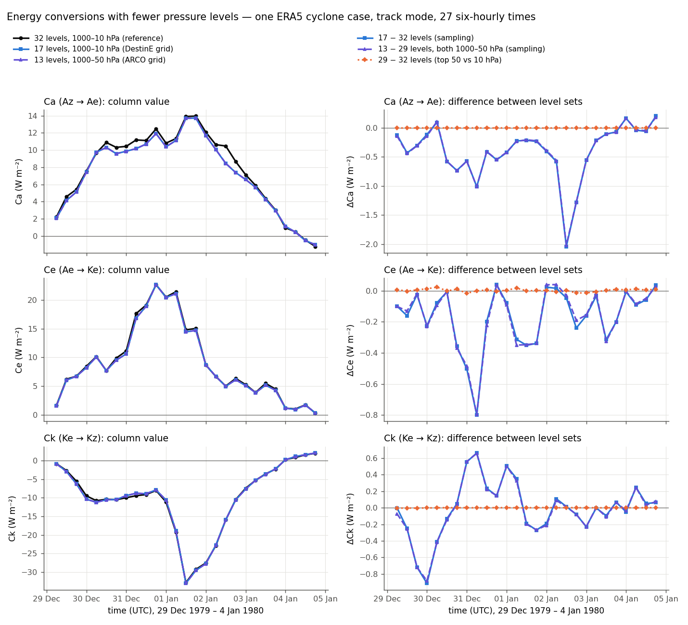
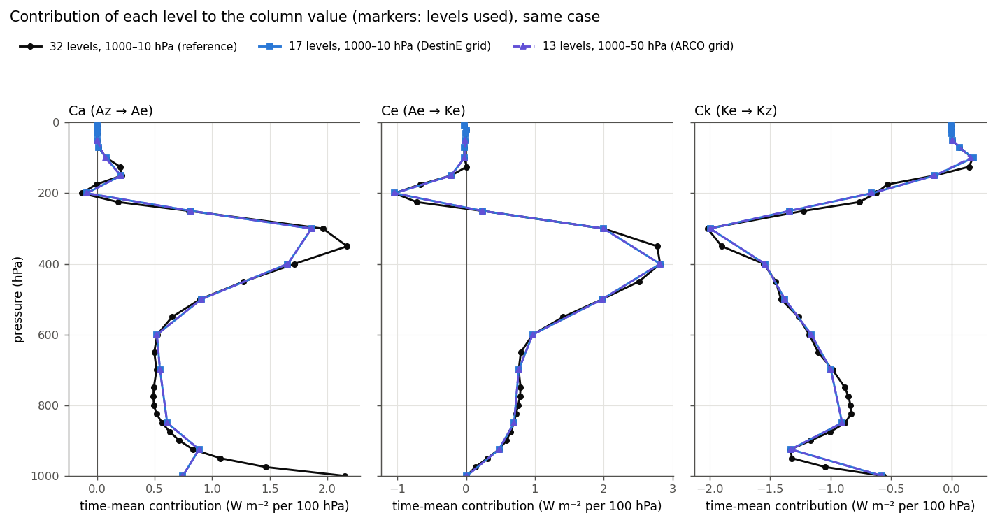
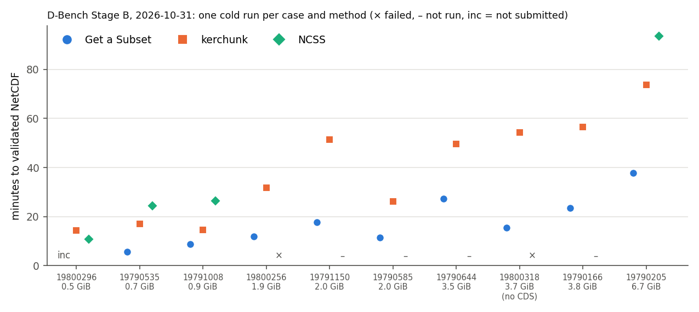
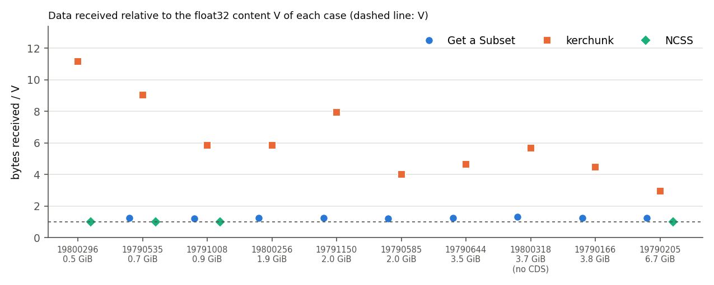

.. _remote-data-acquisition:

Remote Data Acquisition Methods
===============================

.. raw:: html

   

The toolkit always computes the energetics from **one NetCDF file** of pressure-level fields. You can prepare that
file yourself (the main route: give its name as ``infile``), or let the toolkit download it from one of **seven
ERA5 routes** before the run. This page tells you, for each route, how to use it, what it needs (account, token,
package), what time and volume to expect, how its data differ from those of the Copernicus Climate Data Store (CDS),
and its limitations and best uses.

All routes deliver the same reanalysis, ERA5. They differ in the pressure levels and time step of the product, in
how the values are stored, and in how the data travel. This page shows those differences; it does **not** name one
source as the correct one. The CDS is used as the reference of the comparisons only by convention.

.. contents:: On this page
   :local:
   :depth: 2

.. note::

   **How to read the numbers.** Every time and volume on this page is **what we observed** in a stated test, on
   stated dates, from one processing server in Brazil, for South Atlantic cyclone cases of 1979–1980. Queues,
   network and service load change from day to day. Read the numbers as observations, not as promises; see
   :ref:`rda-comparison`.

.. _rda-quick-choice:

1. Quick choice
---------------

.. _rda-pros-cons:

Pros and cons at a glance
~~~~~~~~~~~~~~~~~~~~~~~~~

A short summary of each route. The details are further down: one section per route in :ref:`rda-methods`, the
data differences in :ref:`rda-science` and the numbers with their caveats in :ref:`rda-comparison`.

.. container:: rda-cards

   .. container:: rda-card

      :ref:`CDS API <rda-cdsapi>` — ``--cdsapi``

      .. container:: rda-card-status

         Status: official

      .. container:: rda-pros

         - the source most ERA5 analyses cite; reference of the comparisons on this page
         - 37 levels, hourly; the most recent data (about 5 days behind real time)
         - area cut on the server: small transfer (0.09 GB per case in the benchmark)

      .. container:: rda-cons

         - queue: a new request waited 2.7 h (median) in the benchmark
         - needs a CDS account and API key

      .. container:: rda-card-more

         :ref:`Details → <rda-cdsapi>`

   .. container:: rda-card

      :ref:`WEkEO <rda-wekeo>` — ``--wekeo``

      .. container:: rda-card-status

         Status: integrated; tested on one case

      .. container:: rda-pros

         - delivered files identical to the CDS for identical requests
         - its own queue, separate from the CDS one; 37 levels, hourly
         - area cut on the server: small transfer (0.11 GB per case)

      .. container:: rda-cons

         - needs a WEkEO account and the extra ``[wekeo]``
         - tested on one case only; its latest date was not checked
         - an order can end in an unknown state (see :doc:`troubleshooting`)

      .. container:: rda-card-more

         :ref:`Details → <rda-wekeo>`

   .. container:: rda-card

      :ref:`kerchunk (NCAR) <rda-kerchunk>` — ``--ncar``

      .. container:: rda-card-status

         Status: official; default of ``--ncar``

      .. container:: rda-pros

         - no account, no token, no queue
         - 37 levels, hourly; differs from the CDS by rounding only

      .. container:: rda-cons

         - transfers much more than it keeps (7.5 GB per case in the benchmark)
         - GDEX copy is months behind the CDS
         - slower than the other routes without a queue (16 min per case)

      .. container:: rda-card-more

         :ref:`Details → <rda-kerchunk>`

   .. container:: rda-card

      :ref:`Get a Subset (NCAR) <rda-subset>` — ``--ncar --ncar-method subset``

      .. container:: rda-card-status

         Status: official

      .. container:: rda-pros

         - area cut on the server (1.1 GB per case)
         - 37 levels, hourly; differs from the CDS by rounding only

      .. container:: rda-cons

         - needs a UCAR/GDEX account and API token
         - waiting for a free request slot took up to 6–8 h
         - GDEX copy is months behind the CDS

      .. container:: rda-card-more

         :ref:`Details → <rda-subset>`

   .. container:: rda-card

      :ref:`NCSS (NCAR) <rda-ncss>` — ``--ncar --ncar-method ncss``

      .. container:: rda-card-status

         Status: experimental

      .. container:: rda-pros

         - no account

      .. container:: rda-cons

         - no success in the benchmark (0 of 16 requests)
         - none of its uses is recommended now

      .. container:: rda-card-more

         :ref:`Details → <rda-ncss>`

   .. container:: rda-card

      :ref:`ARCO (CDS Zarr) <rda-arco>` — ``--arco``

      .. container:: rda-card-status

         Status: integrated; tested on one case

      .. container:: rda-pros

         - no queue; fast in the benchmark (6.8 min per case)
         - recent data (about 5 days behind real time)
         - differs from the CDS by rounding only on its levels

      .. container:: rda-cons

         - only **13 levels** and a **6-hourly** step
         - reads whole stored chunks (2.5 GB per case)
         - needs a CDS API key and the extra ``[arco]``; tested on one case

      .. container:: rda-card-more

         :ref:`Details → <rda-arco>`

   .. container:: rda-card

      :ref:`DestinE (Earth Data Hub) <rda-destine>` — ``--destine``

      .. container:: rda-card-status

         Status: integrated; tested on one case

      .. container:: rda-pros

         - 7.8 min per case in the benchmark
         - hourly data on 19 levels

      .. container:: rda-cons

         - **reduced precision:** 18 of 240 cycle terms differed from the CDS by 1 % to 2.7 %
         - large chunks (60 days × 15° × 15°): a short case transfers many times the values it keeps
         - one request per chunk (about 5,700 for the test case) against a monthly quota of 500,000 per account
         - needs a DestinE account, API key and the extra ``[destine]``

      .. container:: rda-card-more

         :ref:`Details → <rda-destine>`

.. _rda-methods-overview:

The seven routes at a glance
~~~~~~~~~~~~~~~~~~~~~~~~~~~~

All routes take the area and the hours from the track file (see :ref:`rda-requirements`) and write a file that the
toolkit reads with the same namelist rules.

.. list-table:: Access, product and status
   :header-rows: 1
   :widths: 17 20 25 16 22

   * - Route
     - Option
     - Account / token / package
     - Levels / step
     - Status
   * - :ref:`CDS API <rda-cdsapi>`
     - ``--cdsapi``
     - CDS account and API key; no extra package
     - 37 / 1 h
     - official
   * - :ref:`WEkEO <rda-wekeo>`
     - ``--wekeo``
     - WEkEO account; extra ``[wekeo]``
     - 37 / 1 h
     - integrated; tested on one case
   * - :ref:`kerchunk <rda-kerchunk>` (NCAR)
     - ``--ncar`` (default method)
     - none
     - 37 / 1 h
     - official; default of ``--ncar``
   * - :ref:`Get a Subset <rda-subset>` (NCAR)
     - ``--ncar --ncar-method subset``
     - UCAR/GDEX account and API token
     - 37 / 1 h
     - official
   * - :ref:`NCSS <rda-ncss>` (NCAR)
     - ``--ncar --ncar-method ncss``
     - none
     - 37 / 1 h
     - **experimental**
   * - :ref:`ARCO <rda-arco>` (CDS Zarr)
     - ``--arco``
     - CDS API key; extra ``[arco]``
     - **13** / **6 h**
     - integrated; tested on one case
   * - :ref:`DestinE <rda-destine>` (Earth Data Hub)
     - ``--destine``
     - DestinE account and API key; extra ``[destine]``
     - **19** / 1 h
     - integrated; tested on one case

.. list-table:: What we observed (details and caveats in :ref:`rda-comparison`)
   :header-rows: 1
   :widths: 15 24 18 21 22

   * - Route
     - Time per case, 2026-11 benchmark (median)
     - Received per case, benchmark (median)
     - One full test with the main command, 2026-11
     - Difference from the CDS data
   * - CDS API
     - 2.7 h for a new request (queue); 30 s when the same request was repeated
     - 0.09 GB
     - not made
     - reference by convention
   * - WEkEO
     - 1.2 min (possibly served from a cache)
     - 0.11 GB
     - ≈ 24 min (17 min of queue), 1.60 GiB
     - identical for an identical request; rounding only otherwise
   * - kerchunk
     - 16 min
     - 7.5 GB
     - 31 min of acquisition, 9.85 GiB
     - rounding only (≤ 0.043 % in the cycle)
   * - Get a Subset
     - 6.6 min, **plus** waits for a free request slot (up to 6–8 h)
     - 1.1 GB
     - not made
     - rounding only (≤ 0.043 % in the cycle)
   * - NCSS
     - no success (0 of 16)
     - —
     - not made
     - —
   * - ARCO
     - 6.8 min
     - 2.5 GB
     - 13 min 46 s, 4.60 GiB
     - rounding only on the 13 levels; fewer levels
   * - DestinE
     - 7.8 min
     - 3.1 GB
     - 17 min 46 s, 1,528 requests, 8.79 GiB
     - **reduced precision:** 18 of 240 terms of the cycle differed by 1 % to 2.7 %

*Benchmark* (2026-11-10 to 2026-11-18): ten cyclone cases of 1979–1980, area = track + 5°, 13 levels (1000–50 hPa),
6-hourly, three repetitions per case; the median is per case. These requests are smaller than those of the main
command. *Full test*: one case (``19790205``) with the main command, area = track + 15° (225 × 633 points), 34
six-hourly times and all the levels of the product; one run per route.

.. _rda-temporal:

Dates and time steps
~~~~~~~~~~~~~~~~~~~~

All products start in 1940. They differ in how recent their data are and in their time step:

.. list-table::
   :header-rows: 1
   :widths: 18 42 18 22

   * - Route
     - Latest data (when checked)
     - Stored step
     - ``--time-resolution``
   * - CDS API, WEkEO
     - CDS: about 5 days behind real time, updated daily (checked 2026-11-02); WEkEO serves the same CDS dataset
       (its latest date was not checked)
     - 1 h
     - any whole number of hours (default 3)
   * - kerchunk, Get a Subset, NCSS
     - GDEX copy, months behind the CDS: 2026-07-31 when checked on 2026-10-26; updated monthly
     - 1 h
     - any whole number of hours
   * - ARCO
     - about 5 days behind real time: 2026-11-18 18 UTC when read on 2026-11-24
     - 6 h (00, 06, 12, 18 UTC)
     - 6, 12, 18 or 24 only; anything else is refused before any read
   * - DestinE
     - v3 store (default): updated monthly, 2026-11-15 23 UTC when read on 2026-11-25; the older v2 store
       (``--destine-store v2``) is no longer updated since 2026-07-06. Later dates are refused before any read
     - 1 h
     - any whole number of hours

End dates move with each update: check the source before choosing a route for a recent case
(`CDS ERA5 pressure levels <https://cds.climate.copernicus.eu/datasets/reanalysis-era5-pressure-levels>`_,
`ECMWF ERA5 ARCO documentation <https://confluence.ecmwf.int/pages/viewpage.action?pageId=639215289>`_,
`NCAR GDEX d633000 <https://gdex.k8s.ucar.edu/datasets/d633000/>`_,
`DestinE ERA5 pressure levels <https://earthdatahub.destine.eu/collections/era5/datasets/era5-pressure-levels>`_).

.. _rda-conclusions:

Choosing by purpose
~~~~~~~~~~~~~~~~~~~

These are criteria, not a ranking.

.. list-table::
   :header-rows: 1
   :widths: 38 62

   * - If ...
     - consider ...
   * - you have no account, or cannot keep a personal token
     - ``--ncar`` (kerchunk, the default method): no account; it transfers much more than it keeps.
   * - the case is recent (after the GDEX copy)
     - ``--cdsapi`` or ``--wekeo``; ``--arco`` if 13 levels and 6 h are acceptable; ``--destine`` up to its last
       monthly update.
   * - you want the data that most ERA5 analyses cite, or must reproduce an earlier CDS run
     - ``--cdsapi``; ``--wekeo`` delivered identical files for identical requests.
   * - the CDS queue is too long for you
     - ``--wekeo`` (its own queue), or the routes without a queue: ``--ncar`` (kerchunk) and ``--arco``.
   * - transfer volume is limited
     - routes that cut the area on the server: ``--cdsapi``, ``--wekeo``, Get a Subset. kerchunk, ARCO and DestinE
       read whole stored chunks.
   * - the analysis needs hourly or 3-hourly fields
     - any route except ``--arco``.
   * - you need the 37 levels (vertical structure, budgets, comparison with published magnitudes)
     - ``--cdsapi``, ``--wekeo`` or ``--ncar``; not ``--arco`` (13 levels) or ``--destine`` (19 levels).
   * - the study depends on boundary, generation or residual terms
     - avoid ``--destine``: its reduced precision moved some of those terms by more than 1 % (see
       :ref:`the DestinE warning <rda-destine-warning>`).
   * - results must be compared across cases or with another study
     - one route, one level set and one numeric precision for all cases; report them.

.. _rda-methods:

2. The routes
-------------

.. _rda-requirements:

2.0 Common to all routes
~~~~~~~~~~~~~~~~~~~~~~~~

**What the toolkit reads.** One NetCDF file on a regular latitude–longitude grid with pressure levels and five
fields:

.. list-table::
   :header-rows: 1
   :widths: 30 25 45

   * - Field
     - ERA5 short name
     - Units expected by the ERA5 namelist
   * - Air temperature
     - ``t``
     - K
   * - Geopotential
     - ``z``
     - m\ :sup:`2` s\ :sup:`-2` (geopotential height in m is accepted when the namelist says so)
   * - Vertical velocity (omega)
     - ``w``
     - Pa s\ :sup:`-1`
   * - Zonal wind
     - ``u``
     - m s\ :sup:`-1`
   * - Meridional wind
     - ``v``
     - m s\ :sup:`-1`

**Namelist.** ``--cdsapi``, ``--wekeo``, ``--arco`` and ``--destine`` write the file with the names of the preset
``inputs/namelist_ERA5-cdsapi`` and use that preset both to prepare the data and to compute the cycle; you do not
need to create ``inputs/namelist``. ``--ncar`` writes its file with the names of ``inputs/namelist`` (or
``inputs/namelist.default``, identical to the ERA5 preset) and reads it again. See :doc:`configuration`.

**What a request contains.** Every route derives the same request from the track:

- the extent of the track with a **15° buffer**, rounded outwards to whole degrees, on the 0.25° ERA5 grid;
- the hours of the track on the grid of ``--time-resolution`` (default 3 h): from the first track time, every step,
  up to the last step that does not pass the last track time;
- the levels of the product: 37 (1000–1 hPa) for the CDS, WEkEO and the NCAR methods, 13 for ARCO, 19 for DestinE.

The track defines the area and hours also in fixed mode (``-f``). In float32, the values a case needs weigh

.. math::

   V = 5 \times n_\mathrm{levels} \times n_\mathrm{lat} \times n_\mathrm{lon} \times n_\mathrm{times} \times 4\ \mathrm{bytes}.

The ten cyclone cases of the tests need 0.5 to 6.7 GiB with 37 levels. Routes that read stored chunks (kerchunk,
ARCO, DestinE) transfer several times V; see each section.

**Time step of the data and of the track.** The data may be sampled less often than the track (for example
``--time-resolution 6`` or the 6-hourly ARCO product with a 3-hourly track). In track mode the toolkit then keeps the
track positions at the data times, unchanged, and warns once; nothing is interpolated. Every route checks this
**before** the download. See :ref:`ts-track-alignment`.

.. _rda-levels:

**Nominal and effective levels.** Levels above 10 hPa are discarded before any computation, and only levels
complete inside the box at every time are integrated. The **effective** levels are therefore 32 (1000–10 hPa) for
the 37-level routes, 17 (1000–10 hPa) for DestinE and 13 (1000–50 hPa) for ARCO. Each run records the levels it
used in ``lec_metadata.json`` (``vertical.levels_used_Pa``; see :doc:`results`). Their effect is discussed in
:ref:`rda-vertical`.

**Limits checked before any download.** Except for ``--cdsapi``, every route estimates the volume first and stops,
**without downloading anything**, when the estimate passes ``--max-gib`` (default **20 GiB**) or the free disk. The
message gives the estimate, the limit in force and the ``--max-gib`` needed. The bytes received, failed attempts
included, are counted against the same limit during the transfer. ``--destine`` also limits the number of HTTP
requests (``--max-requests``, default 10 000). With ``--cdsapi``, the size is limited by the CDS itself (per-account
cost limits).

**An existing file is reused.** If the file named on the command line already exists, it is read as it is and
nothing is downloaded. ``--ncar`` reuses it only after checking it against its provenance record, and the guarded
CDS mode refuses it. Use a new file name for a new download.

**Input files are kept.** No input file is deleted unless ``--delete-downloaded-input`` is given; then only a file
that this run downloaded, unchanged, after a successful run. See :doc:`usage`.

**Provenance.** ``lec_metadata.json`` records the SHA-256 of the input file. ``--ncar``, ``--wekeo``, ``--arco``
and ``--destine`` also write ``<file>.provenance.json`` next to the file: the route, the request, the bytes received,
the software versions and the SHA-256 of the file.

**Credentials.** Keep keys and tokens in the files or environment variables that each route reads, with
permissions for the owner only (``chmod 600``). The toolkit never writes them to logs or provenance records.
**Never print them, paste them in issues, logs or notebooks, or commit them.**

**Optional packages.** WEkEO, ARCO and DestinE need extra packages, installed with the extras of the toolkit (see
:doc:`installation`). Without them, the route stops at once with the installation command.

.. _rda-cdsapi:

2.1 CDS API (``--cdsapi``)
~~~~~~~~~~~~~~~~~~~~~~~~~~

**Status:** official.

**How it works.** One job per day of the track, with the five fields together. The Climate Data Store queues the
job, cuts the area and the hours, converts GRIB to NetCDF and makes the file available; the toolkit waits for each
job, downloads it and merges the days.

**Credential, step by step.**

1. Register at the `Climate Data Store <https://cds.climate.copernicus.eu>`_.
2. Accept the ERA5 licence (CC-BY-4.0) in the CDS web interface; without it the request is refused (HTTP 403).
3. Copy your personal API key from your CDS profile into ``~/.cdsapirc`` and make the file private
   (``chmod 600 ~/.cdsapirc``):

   .. code-block:: text

      url: https://cds.climate.copernicus.eu/api
      key: <your-personal-access-token>

**Usage.**

.. code-block:: bash

   python lorenzcycletoolkit.py case.nc -t -r -p --cdsapi --trackfile inputs/track_case
   python lorenzcycletoolkit.py case.nc -t -r -p --cdsapi --time-resolution 6 --trackfile inputs/track_case

``case.nc`` is written by the download. The log shows one line per day with the hours requested and the size
received; ``-v`` adds details. A complete example is Tutorial 3 in :doc:`examples_and_tutorials`.

**What we observed** (2026-11 benchmark, 13 levels, 5° area). The time is almost all queue. New requests took a
median of 2.7 h per case (6.5 min to 4.4 h; 10 of 10 completed). The same requests repeated one or two days later were
ready in about 30 s, probably served from results the CDS had kept (not confirmed); that is the best case, not the
time of a new request. About 0.09 GB per case was received.

**Limitations.**

- Queue waits from minutes to hours; per-account cost limits: ``--time-resolution 1`` over large areas or long
  periods may exceed them; use 3, 6 or 12 hours.
- The 37 levels are always requested.
- **Stopping the client does not cancel a job:** it may stay queued or running and use the account's quota. Check
  the account for pending requests before submitting again.

**Best uses.** Recent cases; analyses that must match the copy of ERA5 most studies cite; small and medium requests
when a queue of hours is acceptable.

**Guarded mode for controlled runs.** ``--cds-max-seconds`` and related options add a global deadline, a private
ledger written before each submission and one submission at a time per account. A job that ended (completed, or
whose download failed) does not block the next submission; a job in an unknown state does, until you check the
account and resolve the ledger. See :doc:`usage`.

.. _rda-wekeo:

2.2 WEkEO (``--wekeo``)
~~~~~~~~~~~~~~~~~~~~~~~

**Status:** integrated (since 2026-11-23); tested on one real case.

**How it works.** The same request as ``--cdsapi`` (area, 37 levels, hours, variables) is sent to the WEkEO
Harmonised Data Access (HDA) service, dataset ``EO:ECMWF:DAT:REANALYSIS_ERA5_PRESSURE_LEVELS``, as **one order per
month**. WEkEO queues the order and delivers NetCDF; the toolkit keeps the hours of the track and writes the same
file contents as ``--cdsapi`` (names, units, dimension order, longitude convention).

**Credential and package, step by step.**

1. Create a free account at `WEkEO <https://www.wekeo.eu/register>`_.
2. Install the optional package: ``pip install -e ".[wekeo]"`` (the ``hda`` client, version 2.40 or later).
3. Put the account in ``~/.hdarc`` (owner-only), or in the environment variables ``HDA_USER`` and ``HDA_PASSWORD``:

   .. code-block:: text

      user: <your-wekeo-username>
      password: <your-wekeo-password>

**Usage.**

.. code-block:: bash

   python lorenzcycletoolkit.py case.nc -t -r --wekeo --trackfile inputs/track_case --time-resolution 6

**Orders are recorded before they are sent.** ``<file>.wekeo-orders.json`` gets an entry before each order and the
order id as soon as WEkEO answers. If a run stops, the same command resumes the recorded orders without sending them
again. If a run stopped while an order was being sent (no id recorded), its remote state is unknown and the route
refuses to continue until you check your WEkEO account and remove that file. The file is deleted at the end of a
successful download, and the order ids go to the provenance record. An order not ready after 1 h stops the run; the
next run resumes it.

**What we observed.**

- *Benchmark* (13 levels, 5° area): median 1.2 min per case (0.4 to 7.3 min), 0.11 GB, 30 of 30. The requests were
  identical in the three repetitions, so WEkEO may have delivered results it had kept: read 1 min as the delivery of
  a ready result, not as the time of a new order.
- *Full test* (2026-11-23, one case, 37 levels, 15° area): one order; **17 min in the queue**, 4.5 min of transfer,
  2 min of assembly, about **24 min** in all; **1.60 GiB** received (the estimate, an upper bound, was 3.54 GiB).

**Limitations.**

- WEkEO documents a limit of 500 downloadable items per hour and no monthly quota.
- The ``hda`` client cannot cancel an order; an interrupted order stays on WEkEO (its id is recorded and resumed).
- Two runs writing the same file at the same time are not prevented.
- The volume estimate is an uncompressed upper bound; the real volume is usually smaller.

**Best uses.** An alternative to the CDS queue with the same request and the same file contents; recent cases;
37 levels.

.. _rda-ncar:

NCAR GDEX routes (``--ncar``)
~~~~~~~~~~~~~~~~~~~~~~~~~~~~~

The three NCAR methods read the GDEX copy of ERA5 (dataset `d633000 <https://doi.org/10.5065/BH6N-5N20>`_, 37
levels, hourly). The method is chosen with ``--ncar-method {kerchunk,subset,ncss}`` (default ``kerchunk``). They
deliver the same values, published **months after** the CDS (see :ref:`rda-temporal`); the last day of the track is
requested first, so an unpublished date fails at once.

Common to the three methods:

- **What is written:** ``case.nc``, written only after every response and the file itself have been checked, and
  ``case.nc.provenance.json`` (URL, size and SHA-256 of every response, SHA-256 and numeric type of the file, how
  the request was derived from the track, software versions and timings).
- **Checks:** every response is checked (HTTP status, size, NetCDF signature, variable, times, levels, latitudes
  and longitudes, no missing or non-finite values).
- **Running again:** an existing ``case.nc`` is never overwritten; it is reused only if it matches its provenance
  record, has the same variable names and numeric type and covers the whole request. An interrupted retrieval keeps
  its verified pieces in ``case.nc.parts/`` and downloads only what is missing. A lock ``<file>.lock`` stops a second
  download of the same file.
- **Precision:** the values are kept as delivered, float32, in compressed NetCDF-4. In a two-day test (2026-10-27),
  float32 and float64 copies of the same values gave results that differed by at most 2.7 × 10\ :sup:`-7` of the
  largest value of each output column.
- **Standalone retrieval:** ``python -m src.utils.ncar_gdex case.nc --trackfile ... --method kerchunk`` downloads
  the file without computing the cycle. Add ``--dry-run`` to see the requests and their size first. It also accepts
  ``--workers``, ``--max-gib``, ``--float64``, ``--no-compress`` and ``--keep-parts`` (see its ``--help``).
- **Citation:** ECMWF (2019), ERA5 Reanalysis (0.25 Degree Latitude-Longitude Grid), Research Data Archive at the
  National Center for Atmospheric Research, Computational and Information Systems Laboratory,
  https://doi.org/10.5065/BH6N-5N20, together with the Copernicus terms of use of ERA5 (CC-BY-4.0).

.. _rda-kerchunk:

2.3 NCAR GDEX kerchunk (``--ncar``, default method)
~~~~~~~~~~~~~~~~~~~~~~~~~~~~~~~~~~~~~~~~~~~~~~~~~~~

**Status:** official; the default method of ``--ncar`` since 2026-11-19.

**How it works.** GDEX publishes kerchunk reference files (JSON) that map every chunk of its NetCDF-4 files to a
byte range. A chunk is one field, one hour, all 37 levels and the **whole globe** (721 × 1440 points). The toolkit
reads only the chunks of the hours it needs, with HTTPS range requests, and cuts the area locally.

**Credential.** None. The reference files (one per field and decade, 14 to 28 MB each) are kept in
``inputs/kerchunk_refs`` (or ``--kerchunk-refs DIR``) and downloaded once, only for the fields and decades of the
request, when missing. With kerchunk the volume check needs these files, so missing ones are downloaded before it.

**Usage.**

.. code-block:: bash

   python lorenzcycletoolkit.py case.nc -t -r --ncar --trackfile inputs/track_case --time-resolution 6
   python lorenzcycletoolkit.py case.nc -t -r --ncar --trackfile inputs/track_case --max-gib 30

**What we observed.**

- *Benchmark* (13 levels, 5° area): median 16 min per case (6.9 to 33 min), 7.5 GB received, 30 of 30, including the
  cases that cross Greenwich.
- *Full test* (2026-11-23, one case, 37 levels, 15° area, 34 times): 31 min of acquisition (28 min of transfer),
  **9.85 GiB** received in 170 requests, no retry; the file was bit-identical to the benchmark data on the common
  region. In another test the same day, the download of one reference file failed four times on the server's
  connection; running again reused the files already downloaded.

**Limitations.** The whole globe is transferred for every field and hour, so the volume grows with the number of
times and does **not** shrink with the area: the 8-day test case at 6 h needed about 10 GiB, so a longer track or a
3-hour step can pass the 20 GiB default (raise it with ``--max-gib``). The connection to the GDEX file server was intermittent in one test.

**Best uses.** No account or token; no queue; historical cases (before the GDEX end date); runs that must resume
chunk by chunk.

.. _rda-subset:

2.4 NCAR GDEX Get a Subset (``--ncar --ncar-method subset``)
~~~~~~~~~~~~~~~~~~~~~~~~~~~~~~~~~~~~~~~~~~~~~~~~~~~~~~~~~~~~

**Status:** official.

**How it works.** An asynchronous request through the GDEX API: the toolkit submits the dataset, dates, fields and
area, waits until the request is ``Completed``, lists its output files and downloads them. The server cuts the area;
every hour of the date range is delivered (one NetCDF-4 file per field and day) and the track hours are picked
locally.

**Credential, step by step.**

1. Create a UCAR/GDEX account and obtain its personal API token from the GDEX service.
2. Put the token in the environment variable ``GDEX_API_TOKEN`` or in the file ``~/.gdex_api_token`` (owner-only).
   The token is sent with every API call: keep it out of logs, shell history and shared files.

**Usage.**

.. code-block:: bash

   python lorenzcycletoolkit.py case.nc -t -r --ncar --ncar-method subset --trackfile inputs/track_case

**What we observed** (benchmark, 13 levels, 5° area): median **6.6 min** per request (2.6 to 12.6 min), 1.1 GB
received. That time does **not** include the wait for a free request slot: GDEX allows few open requests per account
and clears purged ones in batches, so the 20 waits of the benchmark added 46 h in all, the longest 6 to 8 h. 13 of
the 20 cases that ran completed. Most failures (two cases, "file larger than the limit") came from the toolkit's own
size check, which counted the chunked transfer framing; this was corrected on 2026-11-19 and the corrected size check
was confirmed on one file, but a full case was not retrieved again with this method after the correction.

**Limitations.**

- At most 8 open requests per account; the toolkit submits nothing while 7 are listed (requests "Set for Purge" are
  not counted). A request is purged after 7 days, and a purge takes hours.
- **Identical requests are deduplicated:** while a request is listed, in any state, submitting it again returns the
  old one. Never "force" a new request by changing its scientific parameters.
- A submission may take more than two minutes to be answered.
- Disk holds every hour of the date range before the merge.

**Best uses.** Server-side cut with compressed files (about 1.2–1.3 × V in earlier tests); when a GDEX account is
available and waits of hours for a slot are acceptable.

.. _rda-ncss:

2.5 NCAR GDEX NCSS (``--ncar --ncar-method ncss``)
~~~~~~~~~~~~~~~~~~~~~~~~~~~~~~~~~~~~~~~~~~~~~~~~~~

**Status:** **experimental.** It was the default of ``--ncar`` until 2026-11-19.

**How it works.** Synchronous HTTP requests to the THREDDS NetCDF Subset Service of GDEX, one per field and day (two
when the area crosses Greenwich). The server cuts the area and answers on the same connection. Each request is tried
up to 4 times (waits of 10, 30 and 90 s); an attempt fails after 300 s without data.

**Credential.** None.

**What we observed.** **No success in the 2026-11 benchmark** (0 of 12 in the first campaign, 0 of 16 in the second):
timeouts, HTTP 504 and incomplete responses from the GDEX server. In earlier tests (2026-10-30 and 2026-10-31) four
cases completed and two failed.

**Limitations.** One long synchronous response per request; the service failed repeatedly in 2026-11.

**Best uses.** None recommended now; kept for comparison and in case the service becomes reliable again.

.. _rda-arco:

2.6 CDS ARCO Zarr (``--arco``)
~~~~~~~~~~~~~~~~~~~~~~~~~~~~~~

**Status:** integrated (since 2026-11-24); tested on one real case.

.. warning::

   ``--arco`` delivers **13 pressure levels** (1000, 925, 850, 700, 600, 500, 400, 300, 250, 200, 150, 100 and
   50 hPa; nothing interpolated or completed) **every 6 hours**. Terms of the cycle can differ from the 37-level
   routes: in the one case measured, Ca was 5 % lower on average (see :ref:`rda-vertical`). The program repeats this
   warning at the start of the run and in the provenance record.

**How it works.** The toolkit reads ECMWF's *Analysis Ready, Cloud Optimised* (ARCO) ERA5 store, a Zarr archive read
over HTTPS, without a queue. Each stored chunk holds one time and one level for **721 latitudes × 1024
longitudes**, so a regional case reads whole latitude bands. The toolkit cuts the area and the hours and writes the
same file contents as ``--cdsapi``.

**Credential and package, step by step.**

1. Use the CDS account and API key of ``--cdsapi`` (see :ref:`rda-cdsapi`); the key is sent as a bearer token. In
   our tests no other licence was asked.
2. Install the optional packages: ``pip install -e ".[arco]"`` (zarr 3, numcodecs, fsspec, aiohttp; the store is in
   Zarr format 2, which zarr 3 reads).
3. The key is read from ``CDSAPI_KEY``, or from the file named by ``CDSAPI_RC``, or from ``~/.cdsapirc``.

**Usage.**

.. code-block:: bash

   python lorenzcycletoolkit.py case.nc -t -r --arco --trackfile inputs/track_case --time-resolution 6

``--time-resolution`` must be a multiple of 6 (6, 12, ...); anything else, including the default 3, is refused
before any read.

**What we observed.**

- *Benchmark* (13 levels, 5° area): median 6.8 min per case (2.6 to 20 min), 2.5 GB received, 30 of 30.
- *Full test* (2026-11-24, one case, 15° area, 34 times): 4,420 chunks; **4.60 GiB** received (the upper bound
  checked before reading was 12.16 GiB), 3.9 × the values kept; **13 min 46 s** in all, after a correction of the
  client (the first run took 50 min). No retry.

**Limitations.**

- 13 levels and a 6-hourly step (see the warning above).
- The transfer is several times the values kept (whole chunks): 3.9 to about 10 × in our tests, depending on the
  area.
- The ECMWF guide declares no usage limits, and warns that formats may change.
- The bytes counted are those of the response bodies; HTTP and TLS overheads are not counted.

**Best uses.** No queue; recent cases (updated daily); 6-hourly analyses where 13 levels are acceptable, such as the
time evolution of the conversions.

.. _rda-destine:

2.7 DestinE Earth Data Hub (``--destine``)
~~~~~~~~~~~~~~~~~~~~~~~~~~~~~~~~~~~~~~~~~~

**Status:** integrated (since 2026-11-24); tested on one real case.

.. warning::

   ``--destine`` delivers the product's own **19 pressure levels** (1000 to 1 hPa, not interpolated; 17 are used,
   down to 10 hPa) and **values stored with reduced precision** (10 bits of mantissa). In the 2026-11 comparison, 18 of
   240 terms of the cycle differed from the CDS by 1 % to 2.7 % (see :ref:`the DestinE warning <rda-destine-warning>`).
   The program repeats these warnings at the start of the run, in the file and in the provenance record.

**How it works.** The toolkit reads the ERA5 Zarr store of the Destination Earth (DestinE) Earth Data Hub over
HTTPS, without a queue. Every chunk read is **one HTTP request** against the account's monthly quota. Two stores can
be chosen with ``--destine-store``:

.. list-table::
   :header-rows: 1
   :widths: 14 43 43

   * -
     - ``v3`` (default)
     - ``v2``
   * - Store
     - ``era5-pressure-levels-v0.zarr`` (Zarr format 3)
     - ``reanalysis-era5-pressure-levels-v0.zarr`` (Zarr format 2), used in the 2026-11 benchmark
   * - Updates
     - monthly
     - none since 2026-07-06; may be withdrawn without notice
   * - Chunk
     - 1440 hours (60 days) × 1 level × 60 × 60 points (15° × 15°)
     - 120 hours × 1 level × 256 × 256 points (64° × 64°)
   * - Values
     - 10 bits of mantissa (its metadata declare 13 bits, but in our test its values were those of the v2 store)
     - 10 bits

In the full test (2026-11-25, one case), the files of the two stores held **identical values, bit for bit**: the same
data in other chunks. For a short case the v2 store needs fewer requests and bytes (its chunks are shorter in time);
the v3 store is the one that is kept up to date.

**Credential and package, step by step.**

1. Create a DestinE platform account and generate a personal API key on the
   `Earth Data Hub key page <https://earthdatahub.destine.eu/quota-api-keys>`_.
2. Install the optional packages: ``pip install -e ".[destine]"`` (the same as ``[arco]``: zarr 3, numcodecs,
   fsspec, aiohttp).
3. Put the key in ``~/.netrc`` (owner-only), as the Earth Data Hub recommends, or in the environment variable
   ``DESTINE_EDH_TOKEN`` (a variable of the toolkit):

   .. code-block:: text

      machine data.earthdatahub.destine.eu
        password <your-api-key>

**Usage.** Before reading any chunk, the run shows how many requests and how many bytes it may need, and stops if
they pass the limits:

.. code-block:: bash

   python lorenzcycletoolkit.py case.nc -t -r --destine --trackfile inputs/track_case --time-resolution 6 --max-gib 112
   python lorenzcycletoolkit.py case.nc -t -r --destine --destine-store v2 --trackfile inputs/track_case --max-requests 2000 --max-gib 46

With the v3 store, the default ``--max-gib`` (20 GiB) is usually too small, because the limit is checked on whole
uncompressed chunks of 60 days: the refusal says the value needed. For the 8-day test case below the v3 store needs
about 5,700 requests and an upper bound of 112 GiB; the v2 store needed 1,528 requests and 46 GiB.

**What we observed.**

- *Benchmark* (13 levels, 5° area): median 7.8 min per case (2.6 to 19 min), 3.1 GB received, 27 of 30 (two network
  failures and one passing data defect in the first repetition).
- *Full test, v2 store* (2026-11-24, one case, 19 levels, 15° area, 34 times): **1,528 requests** (0.3 % of the
  monthly quota), all HTTP 200, no retry; **8.79 GiB** received (the upper bound checked before reading was
  45.23 GiB), 5.4 × the values kept; **17 min 46 s** in all.
- *Full test, v3 store* (2026-11-25, the same case): **5,707 requests** (1.1 % of the monthly quota), all HTTP 200,
  no retry; **24.67 GiB** received (upper bound 111.82 GiB), 14 × the values kept; **51 min 36 s** in all. Values
  and cycle identical, bit for bit, to those of the v2 store.

**Limitations.**

- **Store dates:** the v3 store ends at its last monthly update; the v2 store has no data after 2026-07-06 and may
  be withdrawn without notice. Later dates are refused before any read.
- **Quota:** 500,000 requests per month per account, renewed on the 1st; beyond it the service answers HTTP 429 and
  the run stops. The toolkit limits each run (``--max-requests``), not the month: check the usage on your account
  page.
- **Reduced precision** and **19 levels** (see the warning above).
- Large chunks: the transfer is many times the values kept, and the limit is checked on an upper bound. For the
  8-day test case that bound was 45 GiB with the v2 store, so ``--max-gib 46`` was needed although 8.79 GiB
  arrived; with the v3 store it is about 112 GiB.

**Best uses.** Hourly fields without a queue, up to the last monthly update, when the transfer of whole chunks is
acceptable; comparison with the other products.

.. _rda-science:

3. Differences in the data
--------------------------

.. _rda-precision:

3.1 Three groups of products
~~~~~~~~~~~~~~~~~~~~~~~~~~~~

In the 2026-11 benchmark, the same ten cases were downloaded by six routes (NCSS had no success) and the toolkit was
run on every file with the same code and configuration (fixed box, 13 levels, 1000–50 hPa). Each route was compared
with the CDS. The files formed **three groups**, identical within each group:

.. list-table::
   :header-rows: 1
   :widths: 24 38 38

   * - Group
     - Input fields against the CDS
     - Lorenz energy cycle against the CDS
   * - **CDS, WEkEO**
     - identical
     - identical (240 of 240 terms)
   * - **ARCO, kerchunk, Get a Subset**
     - rounding only: at most 2.4 × 10\ :sup:`-4` K in temperature and 0.0625 m\ :sup:`2` s\ :sup:`-2` in
       geopotential; winds and omega identical
     - small differences, at most 0.043 % of the scale of a term; no sign change
   * - **DestinE**
     - steps of reduced precision: up to 0.125 K in temperature and 64 m\ :sup:`2` s\ :sup:`-2` in geopotential (at
       the top); small differences in winds and omega; mean bias negligible
     - **18 of 240** terms differ by 1.04 % to 2.67 % (see below); the others are small; no sign change

"Small" and "relevant" refer to thresholds fixed before the comparison (1 % of the scale of each term for the cycle);
a relevant difference does not by itself change a meteorological conclusion. The comparison shows the differences;
it does not establish which group reproduces the original ERA5 GRIB most faithfully.

**WEkEO equals the CDS only for identical requests.** In the full test of ``--wekeo`` (15° area, 37 levels), its
winds and omega were identical to the CDS benchmark data, but temperature and geopotential differed by rounding (at
most 1.2 × 10\ :sup:`-4` K and 0.003 m\ :sup:`2` s\ :sup:`-2`), and the cycle by at most 0.007 %. A likely
explanation, not verified, is that the service packs the values again for each requested area.

.. _rda-destine-warning:

.. warning::

   **DestinE: reduced precision.** Over the ten cases, the 18 terms that differed from the CDS by more than 1 % were
   **boundary terms** (BΦE six times, BΦZ four times, BAe once), **generation terms** (Gz and Ge, twice each) and
   **residuals** (RGz three times). The energy contents, conversions and tendencies changed by less than 1 %. The
   affected terms depend on the geopotential at the walls of the box or close the budget by difference. In the full
   test of ``--destine`` (one case), only BΦE passed 1 % (1.21 %; 1.24 % in the benchmark for the same case). These
   results are for the v2 store; the v3 store gave the same values. The cause of the steps was confirmed on
   2026-11-25: the values are rounded to 10 bits of mantissa (bit rounding declared in the v2 store metadata; in the
   files of both stores the last 13 bits of every value are zero).

**Full tests with the main command against the CDS** (one case, 34 times, computed on the benchmark grid):

.. list-table::
   :header-rows: 1
   :widths: 20 80

   * - Route
     - Largest difference in the cycle
   * - WEkEO
     - 0.007 % (RGz); no sign change
   * - ARCO
     - 0.007 % (RGz); identical to the ARCO and kerchunk benchmark data
   * - DestinE
     - BΦE 1.21 %; all the others below 1 %; energy contents and conversions ≤ 0.03 %; identical to the DestinE
       benchmark data

.. _rda-vertical:

3.2 Vertical levels: how Ca, Ce and Ck change
~~~~~~~~~~~~~~~~~~~~~~~~~~~~~~~~~~~~~~~~~~~~~

The comparisons above use the same 13 levels for every route. The level set of each product is a separate effect,
measured so far on **one case only**.

**The experiment** (2026-11-02). One cyclone case (29 December 1979 – 4 January 1980, 27 six-hourly times) was
computed several times from the **same** 37-level CDS file, keeping different subsets of its levels. The values on
the kept levels are bit-identical, so only the vertical grid changes:

- number and spacing of levels in the same layer: 32 → 17 levels over 1000–10 hPa (the DestinE grid), and 29 → 13
  levels over 1000–50 hPa (the ARCO grid);
- top of the column: 32 levels up to 10 hPa → 29 levels up to 50 hPa.

**Why levels matter.** The energy terms are vertical integrals, and Ca and Ce depend on the static stability, a
vertical derivative of temperature. Near the surface the 37-level products have a level every 25 hPa, the 13- and
19-level grids every 75 hPa.

.. list-table:: Change in the column values, time mean over 27 times (reference grid first)
   :header-rows: 1
   :widths: 30 23 23 24

   * - Change of levels (used by LECTK)
     - Ca
     - Ce
     - Ck
   * - 32 → 17, 1000–10 hPa
     - 7.69 → 7.29 W m\ :sup:`-2` (−5.1 %); up to 19.5 % at one time; r = 0.995
     - 9.01 → 8.84 W m\ :sup:`-2` (−1.9 %); up to 5.7 %; r = 0.9996
     - −10.02 → −10.04 W m\ :sup:`-2` (−0.2 %); up to 12.9 %; r = 0.9993
   * - 29 → 13, 1000–50 hPa
     - −5.1 %; up to 19.2 %; r = 0.995
     - −1.8 %; up to 5.9 %; r = 0.9996
     - −0.2 %; up to 12.9 %; r = 0.9993
   * - 32 → 29 (top 10 → 50 hPa)
     - < 0.01 %
     - +0.03 %
     - < 0.01 %

*r* is the correlation of the time series with the reference.

   Column values of Ca, Ce and Ck over the cyclone's life (left) and differences between level sets (right), one
   case, 2026-11-02. Left: 32 levels to 10 hPa (reference), 17 levels to 10 hPa (DestinE grid) and 13 levels to
   50 hPa (ARCO grid). Right: 17 − 32 and 13 − 29 levels (spacing in the same layer) and 29 − 32 levels (top at 50
   instead of 10 hPa).

   Time-mean contribution of each level to the column value (W m\ :sup:`-2` per 100 hPa; markers are the levels
   used), same case. The integral of each profile equals the time mean of the column value of the same run.

What the figures show:

- **Magnitudes:** Ca is the most affected (time mean about 5 % lower, up to about 20 % at single times); Ce changes
  by about 2 %; the column value of Ck barely moves, although its layer contributions change by up to
  ±0.11 W m\ :sup:`-2` and cancel.
- **Near-surface layer:** almost all of the change in mean Ca (−0.396 of −0.399 W m\ :sup:`-2`) comes from
  1000–925 hPa, where the static stability at the lowest level is computed differently with 25- or 75-hPa spacing.
  Part of the domain may lie below the ground at 1000 hPa, where ERA5 values are extrapolated; this layer deserves a
  check before interpreting it physically.
- **Evolution:** the time evolution, the signs and the timing of the strongest values of Ca, Ce and Ck are the same
  with 32, 17 and 13 levels.

**Interpretation.** In this case, fewer vertical levels did not substantively change the physical interpretation of
the energetic evolution of the cyclone. A reduced level set is therefore not necessarily inadequate, but it is not
numerically equivalent to the 37-level products. This is one case, in one season and one region. In the full test of
``--destine``, using its levels up to 10 hPa instead of 50 hPa changed the mean Ck by 12.5 % in that case
(preliminary; an effect of the upper levels, not of 19 against 37 levels).

.. _rda-ncar-cds-37:

3.3 Earlier comparison: NCAR and CDS with 37 levels
~~~~~~~~~~~~~~~~~~~~~~~~~~~~~~~~~~~~~~~~~~~~~~~~~~~

In the earlier acquisition tests (D-Bench, 2026-10), the toolkit was run on NCAR and CDS files of nine cases with
**37 levels**, and every output column was compared with a strict numerical criterion (10\ :sup:`-4` of the typical
size of the column). All terms were within it in four cases; in five, at least one term exceeded it, mostly the zonal
available potential energy (Az), its tendency and the residuals. The largest departure was about 0.07 % of the column
scale. In one case diagnosed, small temperature differences, amplified through the static stability, explained it;
with 13 levels the same kind of differences stayed within the criterion. Per-case results are in
:doc:`remote_data_acquisition_case_details`.

**In practice:** files from different routes are not interchangeable at the 10\ :sup:`-4` level, especially for
tendency and residual terms. Use one route for all the cases of a study.

.. _rda-comparison:

4. About the measurements
-------------------------

.. _rda-test-interpretation:

4.1 What the numbers can and cannot tell you
~~~~~~~~~~~~~~~~~~~~~~~~~~~~~~~~~~~~~~~~~~~~

- **Few measurements.** The benchmark ran each route on ten cases, three times. The full tests with the main command
  ran **once per route, on one case**.
- **Different dates.** ARCO, WEkEO and DestinE were measured on 2026-11-10 to 12; the CDS, kerchunk, Get a Subset
  and NCSS on 2026-11-14 to 18; the full tests on 2026-11-23 and 24. Service load changes; comparisons between
  routes are indicative.
- **Caches.** Identical requests repeated in the benchmark may have been served from results kept by the services.
  WEkEO: about 1 min per case in the benchmark, against 24 min (17 min of queue) for a new order in the full test.
  CDS: 30 s for a repeated request against a median of 2.7 h for a new one.
- **Request size.** The benchmark requests (5° area, 13 levels) are smaller than those of the main command (15°
  area, all levels of the product); expect larger volumes, and longer times for the routes that transfer what they
  receive.
- **One place.** One server and one network in Brazil.

.. _rda-performance:

4.2 Benchmark of 2026-11 (seven routes)
~~~~~~~~~~~~~~~~~~~~~~~~~~~~~~~~~~~~~~~

Time per case is the whole request, queue and checks included; for Get a Subset it excludes the wait for a free
request slot.

.. list-table::
   :header-rows: 1
   :widths: 20 18 14 16 16 16

   * - Route
     - Dates
     - Successes
     - Median per case
     - Range
     - Received per case (median)
   * - CDS ARCO Zarr
     - 2026-11-10 to 12
     - 30 / 30
     - 6.8 min
     - 2.6–20 min
     - 2.5 GB
   * - WEkEO
     - 2026-11-10 to 12
     - 30 / 30
     - 1.2 min
     - 0.4–7.3 min
     - 0.11 GB
   * - DestinE
     - 2026-11-10 to 12
     - 27 / 30
     - 7.8 min
     - 2.6–19 min
     - 3.1 GB
   * - NCAR kerchunk
     - 2026-11-14 to 18
     - 30 / 30
     - 16 min
     - 6.9–33 min
     - 7.5 GB
   * - CDS API, new requests
     - 2026-11-16 to 17
     - 10 / 10
     - 2.7 h
     - 6.5 min–4.4 h
     - 0.09 GB
   * - CDS API, repeated requests
     - 2026-11-18
     - 10 / 10
     - 30 s
     - 15–73 s
     - 0.09 GB
   * - NCAR Get a Subset
     - 2026-11-14 to 18
     - 13 / 20 run
     - 6.6 min
     - 2.6–12.6 min
     - 1.1 GB
   * - NCAR NCSS
     - 2026-11-14 to 18
     - 0 / 16
     - —
     - —
     - —

.. _rda-reliability:

**Failures.** kerchunk: none in 30 runs. CDS: one empty download blocked the guarded mode for the rest of a
repetition (this no longer blocks; see :ref:`rda-cdsapi`). Get a Subset: seven failures in three cases, most from the
toolkit's size check (corrected). NCSS: timeouts, HTTP 504 and incomplete responses in every attempt. DestinE: two
network failures and one passing data defect in the first repetition.

4.3 Full tests with the main command (2026-11-23 and 24)
~~~~~~~~~~~~~~~~~~~~~~~~~~~~~~~~~~~~~~~~~~~~~~~~~~~~~~~~

One case (``19790205``), area = track + 15° (225 × 633 points), 34 six-hourly times, one run per route.

.. list-table::
   :header-rows: 1
   :widths: 16 22 22 20 20

   * - Route
     - Levels
     - Acquisition
     - Received
     - Estimate checked before
   * - kerchunk
     - 37
     - 31 min
     - 9.85 GiB, 170 requests
     - 9.86 GiB (dry run)
   * - WEkEO
     - 37
     - ≈ 24 min (17 min queue)
     - 1.60 GiB, 1 order
     - 3.54 GiB (upper bound)
   * - ARCO
     - 13
     - 13 min 13 s
     - 4.60 GiB, 4,431 reads
     - 12.16 GiB (upper bound)
   * - DestinE
     - 19
     - 16 min 50 s
     - 8.79 GiB, 1,528 requests
     - 45.23 GiB (upper bound)

The CDS API, Get a Subset and NCSS were not run with the main command in these tests.

.. _rda-dbench-history:

4.4 Earlier tests of the NCAR methods (D-Bench, 2026-10-31)
~~~~~~~~~~~~~~~~~~~~~~~~~~~~~~~~~~~~~~~~~~~~~~~~~~~~~~~~~~~

Before the routes were integrated, the three NCAR methods were timed on ten cases with **37 levels** and separate
test clients (not the toolkit's), one run per case and method, on one day. Kept as history; the clients have changed
since.

   D-Bench, 2026-10-31 (history): time to a validated NetCDF file, one run per case and NCAR method, with the test
   clients of that date. Cases are ordered by size. × marks a failed run, – a case not run, "inc" a Get a Subset case
   not submitted.

   D-Bench, 2026-10-31 (history): bytes received (failed attempts included) divided by the values needed, for each
   case.

In those tests Get a Subset took a median of 16 min (6–38 min, 9 cases), kerchunk 41 min (14–74 min, 10 cases) and
NCSS 25 min (11–93 min, 4 cases). The run table is ``_static/remote_data_acquisition/stageB_runs.csv``; the cases are
described in :doc:`remote_data_acquisition_case_details`.

**Details and provenance.** The protocols, sealed requests and per-case results of all these tests are kept in the
permanent records of the project (``docs/evolution/``).

.. _rda-limitations:

5. Known limitations
--------------------

- **ARCO has 13 levels.** Their effect on the cycle was measured on **one case only** (Ca −5 % on average; Ce −1.8 %,
  Ck −0.2 %), by subsampling a CDS file (see :ref:`rda-vertical`).
- **DestinE: reduced precision and large chunks.** Values rounded to 10 bits of mantissa in both stores (see
  :ref:`the DestinE warning <rda-destine-warning>`); the v3 store, the default, was tested on one case, where it gave
  the values of the v2 store. Data added to the v3 store after 2026-07 were not checked. Its chunks of 60 days make
  short cases transfer much more than they keep.
- **NCSS is unreliable:** 0 of 16 in the 2026-11 benchmark; it stays experimental.
- **GDEX publishes months after the CDS:** recent cases need the CDS, WEkEO or ARCO.
- **Get a Subset depends on free request slots:** waits of hours are possible.
- **No route cancels remote work** when the client is stopped: CDS jobs and WEkEO orders stay on the account.
- **Each route was tested with the main command on one case.** Times and volumes for other areas and periods are
  not established.
- **Greenwich:** with the CDS and WEkEO routes, a track given in 0–360° that crosses 0° gives a west edge larger
  than the east edge; give such tracks in −180–180°.
- **Concurrency:** two runs writing the same file at the same time are prevented only for ``--ncar``.
- **Byte counts** include the response bodies, not the HTTP, TLS and TCP/IP overheads; the network traffic is
  slightly larger.
- **Products change:** the ARCO and Earth Data Hub services warn that formats may change; check this page against
  the date of your run.
