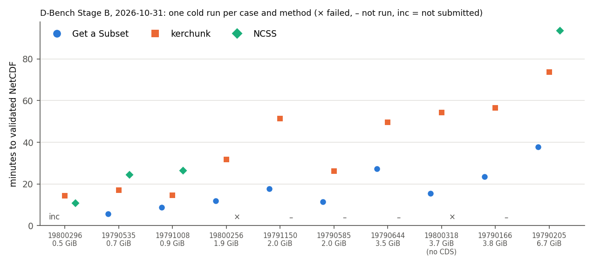
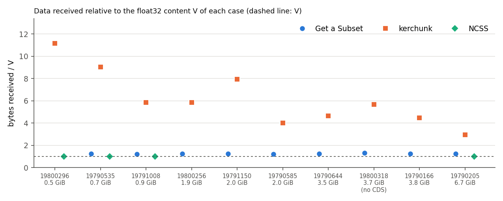
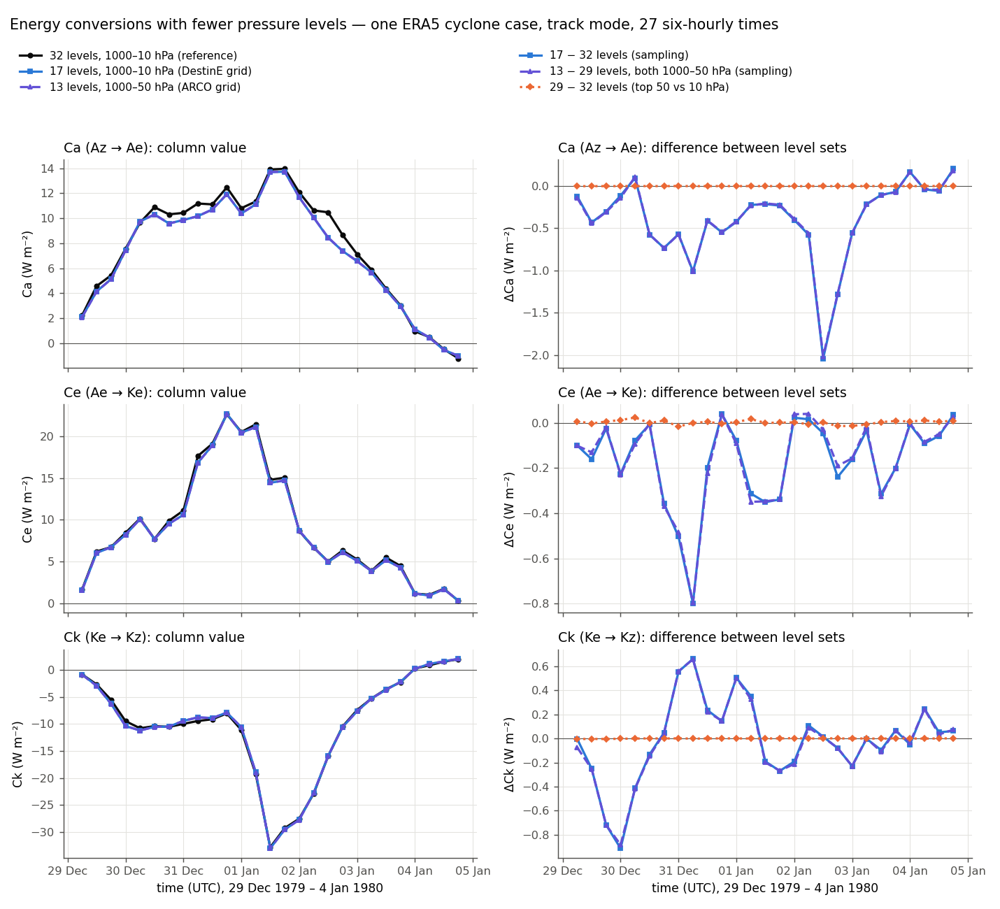
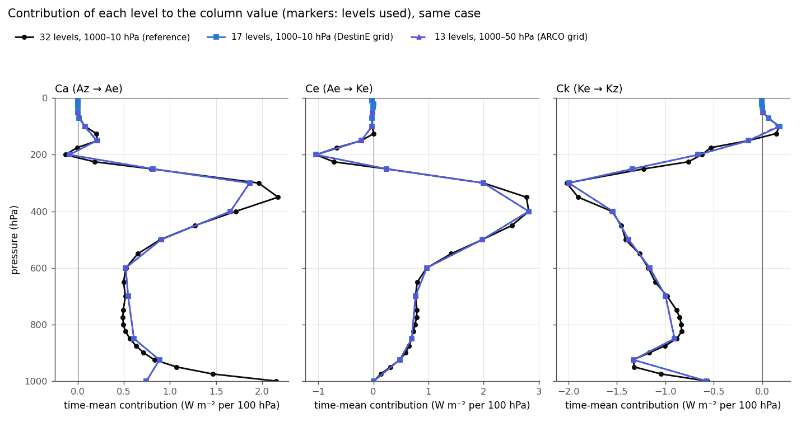

.. _remote-data-acquisition:

Remote Data Acquisition Methods
===============================

.. raw:: html

   

The toolkit always computes the energetics from **one NetCDF file** of pressure-level fields. That file can be
prepared by you, downloaded by the toolkit itself (``--cdsapi``, ``--ncar``), or prepared outside the toolkit from
other ERA5 services. This page is the single reference for all of these routes: what each needs, how to use it,
what was measured with it, and how the ERA5 products differ scientifically.

.. contents:: On this page
   :local:
   :depth: 2

.. note::

   **No method is best everywhere.** The measurements on this page come from a few tests, each on one day,
   from one machine, for cyclone cases of 1979–1980 over the South Atlantic. Transfer times, queues, failures
   and volumes depend on the network, the load of each service, the period requested and the size of the domain.
   Read every number as an observation under the stated conditions, not as a property of the service.

   - **Measured:** observed in a stated run, on a stated date.
   - **Estimated:** computed from sizes or documented limits, not observed.
   - **Hypothesis:** a possible explanation that has not been tested.

.. _rda-requirements:

1. Overview and data requirements
---------------------------------

What the toolkit reads
~~~~~~~~~~~~~~~~~~~~~~

Whatever the route, the input is one NetCDF file on a regular latitude–longitude grid with pressure levels and
five fields:

.. list-table::
   :header-rows: 1
   :widths: 30 25 45

   * - Field
     - ERA5 short name
     - Units expected by the default namelist
   * - Air temperature
     - ``t``
     - K
   * - Geopotential
     - ``z``
     - m\ :sup:`2` s\ :sup:`-2` (geopotential height in m is accepted when the namelist says so)
   * - Vertical velocity (omega)
     - ``w``
     - Pa s\ :sup:`-1`
   * - Zonal wind
     - ``u``
     - m s\ :sup:`-1`
   * - Meridional wind
     - ``v``
     - m s\ :sup:`-1`

The variable and coordinate names, and the units, must match the namelist (see :doc:`configuration`). When
``inputs/namelist`` does not exist, ``inputs/namelist.default`` is used; it describes the NetCDF files that the CDS
delivers for ERA5 (it is identical to the preset ``inputs/namelist_ERA5-cdsapi``). ``--ncar`` writes its file
with the names of the namelist of the run, so the same namelist serves both downloads.

Integrated access and external preparation
~~~~~~~~~~~~~~~~~~~~~~~~~~~~~~~~~~~~~~~~~~

- **Integrated (native) access:** the toolkit derives the request from the track, downloads the fields, writes the
  NetCDF file and runs the energetics in one command (``--cdsapi``, ``--ncar``).
- **Experimental standalone retrieval:** the module ``python -m src.utils.ncar_gdex`` downloads the file without
  running the energetics; besides NCSS it offers two experimental GDEX access methods (``--method kerchunk`` and
  ``--method subset``) that are **not** options of ``lorenzcycletoolkit.py``. They are tested offline only; the
  D-Bench (the project's acquisition benchmark) measurements of these methods were made with separate clients.
- **External preparation:** you obtain the fields with your own tools (for example ``xarray``) and write a NetCDF
  file that matches the contract above; the toolkit then reads it as a local input.

What a track request contains
~~~~~~~~~~~~~~~~~~~~~~~~~~~~~

The integrated routes request the same data for a track:

- the extent of the track with a 15° buffer, rounded outwards to whole degrees, on the 0.25° ERA5 grid;
- the hours of the track on the grid of ``--time-resolution`` (default 3 h): from the first track time on the first
  day, every step on the middle days, up to the last track time on the last day;
- the 37 ERA5 pressure levels, 1000 to 1 hPa.

In float32, the volume of values a case needs is

.. math::

   V = 5 \times n_\mathrm{levels} \times n_\mathrm{lat} \times n_\mathrm{lon} \times n_\mathrm{times} \times 4\ \mathrm{bytes}.

The ten cyclone trajectories examined in the acquisition tests need 0.5 to 6.7 GiB with 37 levels. The methods differ in **how much more than V they
transfer**, **where the area and the hours are cut**, and **when the data start to arrive**.

Time step of the data and of the track
~~~~~~~~~~~~~~~~~~~~~~~~~~~~~~~~~~~~~~~

The data may be sampled less often than the track (for example ``--time-resolution 6`` or a 6-hourly product with
a 3-hourly track). In track mode the toolkit then keeps the track positions at the data times, unchanged, and warns
once; nothing is interpolated. With ``--cdsapi`` and ``--ncar`` this is checked **before** the download. See
:ref:`ts-track-alignment`.

.. _rda-levels:

Vertical levels: nominal and effective
~~~~~~~~~~~~~~~~~~~~~~~~~~~~~~~~~~~~~~

The ERA5 products do **not** all carry the same levels (see :ref:`rda-methods-overview`). Moreover, levels above
10 hPa are discarded before any computation, and only levels complete inside the box at every time step are
integrated. The **effective** levels are therefore 32 (1000–10 hPa) for the 37-level products, 17 (1000–10 hPa)
for the 19-level DestinE grid and 13 (1000–50 hPa) for the 13-level ARCO grid. Each run records the levels it used
in ``lec_metadata.json`` (``vertical.levels_used_Pa``; see :doc:`results`). How much this matters is discussed in
:ref:`rda-science`.

Authentication and provenance
~~~~~~~~~~~~~~~~~~~~~~~~~~~~~

- Keep keys and tokens in the files or environment variables that each client reads, with permissions for the
  owner only (``chmod 600``). **Never print them, paste them in issues, logs or notebooks, or commit them.**
- ``lec_metadata.json`` of every run records the SHA-256 of its input file. ``--ncar`` also writes a provenance
  record next to the file. For externally prepared files, keep your own record of the product, the selection and
  the date of the download.

.. _rda-methods-overview:

Methods at a glance
~~~~~~~~~~~~~~~~~~~

.. list-table::
   :header-rows: 1
   :widths: 22 20 13 9 16 20

   * - Method
     - Product
     - Levels (hPa)
     - Step
     - Account
     - Status in the toolkit
   * - :ref:`CDS API <rda-cdsapi>`
     - CDS ``reanalysis-era5-pressure-levels``
     - 37 (1–1000)
     - 1 h
     - CDS account and key
     - supported: ``--cdsapi``
   * - :ref:`NCAR GDEX NCSS <rda-ncss>`
     - NCAR GDEX ``d633000``
     - 37 (1–1000)
     - 1 h
     - none
     - experimental: ``--ncar``
   * - :ref:`NCAR GDEX Get a Subset <rda-subset>`
     - NCAR GDEX ``d633000``
     - 37 (1–1000)
     - 1 h
     - UCAR/GDEX account and token
     - not in the main command; experimental standalone retrieval
   * - :ref:`NCAR GDEX kerchunk <rda-kerchunk>`
     - NCAR GDEX ``d633000``
     - 37 (1–1000)
     - 1 h
     - none
     - not in the main command; experimental standalone retrieval
   * - :ref:`CDS ERA5 ARCO Zarr <rda-arco>`
     - ECMWF ARCO time-chunked store
     - 13 (50–1000)
     - 6 h
     - see the section
     - external preparation only
   * - :ref:`DestinE ERA5 Zarr <rda-destine>`
     - DestinE Earth Data Hub
     - 19 (1–1000)
     - 1 h
     - DestinE personal token
     - not tested

.. _rda-methods:

2. Acquisition methods
----------------------

.. _rda-cdsapi:

2.1 CDS API — native integration
~~~~~~~~~~~~~~~~~~~~~~~~~~~~~~~~

**Status:** supported (``--cdsapi``).

**Mechanism.** One asynchronous job per day, with the five fields together. The Climate Data Store queues the job,
cuts the area and the hours, converts GRIB to NetCDF and makes the file available. The toolkit waits for each job,
downloads it and merges the days into the file named on the command line.

**Requirements and authentication.**

1. Register at the `Climate Data Store <https://cds.climate.copernicus.eu>`_.
2. Accept the ERA5 licence (CC-BY-4.0) in the CDS web interface; without it the request is refused (HTTP 403).
3. Put your personal key in ``~/.cdsapirc`` (owner-only permissions):

   .. code-block:: text

      url: https://cds.climate.copernicus.eu/api
      key: <your-personal-access-token>

**Usage.**

.. code-block:: bash

   python lorenzcycletoolkit.py case.nc -t -r -p --cdsapi --trackfile inputs/track_case
   python lorenzcycletoolkit.py case.nc -t -r -p --cdsapi --time-resolution 6 --trackfile inputs/track_case

- ``case.nc`` does not need to exist: it is written by the download. **If it already exists, it is used as it is**
  and nothing is downloaded, so a second run with other flags reuses it.
- The track defines the area and hours also in fixed mode (``-f``).
- No input file is deleted after a run unless ``--delete-downloaded-input`` is given (see :doc:`usage`).
- The log shows one line per day with the hours requested and the size received, then the merged file and its time
  coverage; ``-v`` adds timing details.

**Data.** ERA5 at 0.25°, 37 levels, 1940 to a few days before today, NetCDF as converted by the CDS.

**Advantages.** The most recent dates; area and hours cut on the server (about V transferred, estimated); the
copy of ERA5 most analyses cite.

**Limitations.** Queue waits that vary from minutes to hours; per-account queue and cost limits —
``--time-resolution 1`` over large areas or long periods may exceed them; use 3, 6 or 12 hours. The 37 levels are
always requested.

**Operational considerations.** Stopping the client does **not** cancel a job: it may stay queued or running and
use the account's quota. Check the account for pending requests before submitting again. For controlled runs
(benchmarks), the opt-in guarded mode (``--cds-max-seconds`` and related options) adds a deadline, a ledger and
one submission at a time per account; see :doc:`usage`.

.. _rda-ncss:

2.2 NCAR GDEX NCSS — experimental native integration
~~~~~~~~~~~~~~~~~~~~~~~~~~~~~~~~~~~~~~~~~~~~~~~~~~~~

**Status:** experimental (``--ncar``). Validated on one two-day case: its values were bit-identical to an earlier
download of the same GDEX data, and the toolkit reproduced that case's results byte for byte. Its options and
messages may still change.

**Mechanism.** Synchronous HTTP requests to the THREDDS NetCDF Subset Service of the NCAR Geoscience Data Exchange
(GDEX, dataset `d633000 <https://doi.org/10.5065/BH6N-5N20>`_), one per field and day (two when the area crosses
Greenwich). The server cuts the area and picks the hours and answers on the same connection; there is no job
queue, but each response still takes seconds to be prepared. The toolkit checks every response and writes one file.

**Requirements and authentication.** None (no account).

**Usage.** Show the requests and their size first, then run:

.. code-block:: bash

   python -m src.utils.ncar_gdex case.nc --trackfile inputs/track_case --time-resolution 6 --dry-run
   python lorenzcycletoolkit.py case.nc -t -r --ncar --trackfile inputs/track_case --time-resolution 6

``--ncar`` and ``--cdsapi`` cannot be used together. The standalone command (without ``--dry-run``) downloads the
file without running the energetics and also accepts ``--workers`` (up to 4 requests at a time), ``--max-gib``
(largest volume received), ``--float64``, ``--no-compress`` (NetCDF-3) and ``--keep-parts``.

**Data.** The same ERA5 analysis, converted from GRIB by GDEX. GDEX publishes ERA5 **some months after** the CDS
(on 2026-10-26 it covered 1940-01-01 to 2026-07-31; check the `dataset page <https://doi.org/10.5065/BH6N-5N20>`_).
The last day of the track is requested first, so an unpublished date fails at once, before anything else is
downloaded. The values are kept as delivered (float32), without interpolation or unit conversion, in compressed
NetCDF-4, with the variable names of the namelist (which must describe geopotential, not geopotential height).

**What is written.**

- ``case.nc``, written only after every response and the file itself have been checked;
- ``case.nc.provenance.json``: URL, size and SHA-256 of every response, the SHA-256 and numeric type of
  ``case.nc``, how the request was derived from the track, software versions and timings.

**Checks and limits.**

- Every response: HTTP status, size and NetCDF signature; variable and units; times, levels, latitudes and
  longitudes exactly those requested; no missing or non-finite values.
- **Volume:** 8 GiB per retrieval by default. Every byte read from the service is counted, failed attempts
  included; each request reserves the most its response may hold before it is made, and no request is made that
  could pass the limit. TLS and TCP/IP overheads are not counted, so the network traffic is slightly larger.
- **Time:** an attempt fails after 300 s without data, or when it lasts longer than 300 s plus the time its
  largest response takes at 25 kB/s.
- **Retries:** network failures, cut or too slow responses and HTTP 429/5xx are attempted up to 4 times, waiting
  10, 30 and 90 s (or the longer ``Retry-After``; over 300 s the program stops and asks to run again later).
- **Stops at once** on a refused request (4xx), a redirect, a page that is not NetCDF (e.g. maintenance), a
  response larger than its reservation or a response that is not the requested data.
- **One download per file:** a lock ``<file>.lock`` stops a second download of the same file; a killed download
  does not block the next one.

**Running again.** An existing ``case.nc`` is never overwritten. It is reused only if its provenance record matches
its SHA-256, it has the same variable names and numeric type, and it covers the whole request; otherwise the
program stops and explains why (run without ``--ncar`` to use any NetCDF file as a plain local input). An
interrupted retrieval keeps its verified responses in ``case.nc.parts/`` and downloads only what is missing. A
misspelt file name starts a new download: use ``--dry-run`` first.

**Costs (measured in the validation, 2026-10-27, from Brazil).** No money. About 4 bytes per value: a two-day track
at 6-hour resolution over 129 × 129 points needed 10 requests of 9.9 MB (94 MiB). Each response waited 6 to 24 s
before its first byte and then arrived at about 3 MB/s. The compressed file was 44 % of the volume downloaded.

**Precision.** The toolkit computes in the numeric type of its input file; ``--ncar`` keeps float32 by default. In
the two-day case, float32 and float64 copies of the same values gave fixed and moving results that differed by at
most 2.7 × 10\ :sup:`-7` of the largest value of each output column, with no sign change. ``--float64`` costs about
3 % more disk, twice the input memory and, in the moving framework, about twice the time. The regression references
of the test suite were computed from float64 input. A float64 file is not reused by a float32 request, nor the
reverse.

**Limitations and failures.** One long synchronous response per request. In the D-Bench tests of 2026-10-30 and
2026-10-31 four runs failed, two on each day, on domains of 1.9 to 3.9 GiB: a request got no response within 300 s,
or HTTP 503/504 from the GDEX front end, four times in a row; the largest domain (6.7 GiB) succeeded. The cause
(service load, particular files, or both) has **not** been established.

**Citation.** ECMWF (2019), ERA5 Reanalysis (0.25 Degree Latitude-Longitude Grid), Research Data Archive at the
National Center for Atmospheric Research, Computational and Information Systems Laboratory,
https://doi.org/10.5065/BH6N-5N20, together with the Copernicus terms of use of ERA5 (CC-BY-4.0).

.. _rda-subset:

2.3 NCAR GDEX Get a Subset — external method
~~~~~~~~~~~~~~~~~~~~~~~~~~~~~~~~~~~~~~~~~~~~

**Status:** experimental standalone method; not selectable through ``--ncar`` or any option of
``lorenzcycletoolkit.py`` (a ``--ncar-method`` selector is specified for the future but **not** implemented).

- *In the code:* ``python -m src.utils.ncar_gdex case.nc --trackfile ... --method subset``.
- *Tested:* offline only, against emulated GDEX services (``tests/test_gdex_sources.py``).
- *Benchmarked:* in D-Bench, with a separate instrumented client, not with this module.
- *Not demonstrated:* the times and reliability of the current standalone implementation against the real
  service.

**Mechanism.** An asynchronous request through the GDEX API: the client submits a control document (dataset, date
range, fields, area), polls the request until it is ``Completed``, lists its output files and downloads them. The
server cuts the area; the output is one NetCDF-4 file per field and day. The request has no time step, so **every
hour** of the date range is delivered; the track hours are picked locally and the files are merged into one file.
An area crossing Greenwich needs only one request (measured): the files hold both sides in 0–360° order.

**Requirements and authentication.** A UCAR/GDEX account and its personal API token. The standalone module reads it
from ``GDEX_API_TOKEN`` or ``~/.gdex_api_token`` (owner-only). The token is sent with every API call: keep it out of
logs, shell history and shared files.

**Preparing a file.** Either use the experimental standalone module, or prepare the files yourself and merge them
into one NetCDF file with the five fields, the track hours and names matching the namelist (see
:ref:`rda-requirements`).

**Data.** Same values as NCSS: in the D-Bench tests the files of the three GDEX methods were identical value by value.

**Advantages.** Server-side area cut with compressed files (measured 1.22–1.30 × V for 3-hourly tracks); short
remote processing in the benchmark (2–6 minutes per request).

**Limitations (documented by GDEX and observed).**

- at most 8 open requests per user; a request is purged after 7 days;
- **identical requests are deduplicated**: while a request is listed, in any state (including ``Set for Purge``),
  submitting it again returns the old one instead of a new run;
- a purge is asynchronous: the request stays ``Set for Purge`` for hours;
- a submission may take more than two minutes to be answered, and the request may be created even when the client
  stopped waiting.

**Operational considerations.** A failed download is repeated from the file list **without a new request**. Never
"force" a new request by changing its scientific parameters. Disk holds every hour of the range before the merge;
with a field-by-field merge, memory stays small (peak RSS 0.43–0.58 GiB measured).

.. _rda-kerchunk:

2.4 NCAR GDEX kerchunk — external method
~~~~~~~~~~~~~~~~~~~~~~~~~~~~~~~~~~~~~~~~

**Status:** experimental standalone method; not selectable through ``--ncar`` or any option of
``lorenzcycletoolkit.py``.

- *In the code:* ``python -m src.utils.ncar_gdex case.nc --trackfile ... --method kerchunk --kerchunk-refs DIR``
  (the reference files must already be in ``DIR``; the module does not download them).
- *Tested:* offline only, against emulated services (``tests/test_gdex_sources.py``).
- *Benchmarked:* in D-Bench, with a separate instrumented client, not with this module.
- *Not demonstrated:* the times and reliability of the current standalone implementation against the real
  service.

**Mechanism.** GDEX publishes kerchunk reference files (JSON) that map every chunk of its NetCDF-4 files to a byte
range. A chunk is one field, one hour, all 37 levels and the **whole globe** (721 × 1440 points), compressed with
zlib and byte shuffle. The client reads only the chunks of the hours it needs with HTTPS range requests,
decompresses them and cuts the area **locally**.

**Requirements and authentication.** No account. The reference files must be obtained first (about 16 MB per field
and decade). They name a host whose TLS certificate failed on 2026-10-30; the benchmark client used another GDEX host
serving the same files.

**Preparing a file.** Read the chunks of the track hours, cut the area and write one NetCDF file matching the
contract in :ref:`rda-requirements`, or use the experimental standalone module.

**Advantages.** No account, no queue and no server-side processing; every chunk is an independent request that can
be retried alone and resumed; no failed range in 2,190 requests in the D-Bench tests.

**Limitations.** The whole globe is transferred for every field and hour, so the volume does not shrink with the
domain (measured 3.0–11.1 × V, more for small domains). Writing chunk by chunk keeps memory small (peak RSS
0.70–0.74 GiB); a prototype that held all fields in memory needed 13.7 GB on the largest case.

.. _rda-arco:

2.5 CDS ERA5 ARCO Zarr — external preparation
~~~~~~~~~~~~~~~~~~~~~~~~~~~~~~~~~~~~~~~~~~~~~

**Status:** not a toolkit route. Assessed once (2026-11-02) by converting a selection to NetCDF outside the toolkit.

**Mechanism.** ECMWF's analysis-ready, cloud-optimised (ARCO) ERA5 store is a Zarr archive read over HTTPS. In the
time-chunked store used here, each chunk holds **one time and one level for 721 latitudes and 1024 longitudes**, so
a regional case downloads whole latitude bands.

**Requirements and authentication.** In the assessment, the existing CDS API key was sent as a bearer token. Whether
the store can be read without an account, and what its access conditions will be, was not established.

**Data.** 13 pressure levels (50–1000 hPa) and a 6-hourly time step; it covered 1940-01-01 to 2026-10-27 18 UTC when
queried (the store is updated daily, about 5 days behind real time; see :ref:`rda-temporal`). With a 3-hourly track, the toolkit keeps the positions at the 6-hourly times (see
:ref:`ts-track-alignment`). Effective levels: 13.

**Preparing a file.** The example below reads the store with ``xarray`` (``zarr`` 2 and ``fsspec`` with
``aiohttp``) and writes a NetCDF file whose names match the default namelist. Adapt the times and area to your
track. The key is read from an environment variable and must not be written into the script.

.. code-block:: python

   import os
   import xarray as xr

   url = ("https://arco.datastores.ecmwf.int/cadl-arco-time-048/arco/"
          "reanalysis_era5_pressure_levels/pl/timeChunked.zarr")
   headers = {"Authorization": f"Bearer {os.environ['CDS_API_KEY']}"}
   ds = xr.open_zarr(url, consolidated=True, storage_options={"headers": headers})
   sel = (ds[["t", "z", "u", "v", "w"]]
          .rename({"time": "valid_time", "pressureLevel": "pressure_level"})
          .sel(valid_time=slice("1979-12-29T06", "1980-01-04T18"),
               latitude=slice(-60, -18), longitude=slice(-82, -6)))
   sel["pressure_level"].attrs["units"] = "hPa"
   sel.load().to_netcdf("case_arco.nc")

**Advantages.** No job queue; its values were bit-identical to NCAR GDEX on the common levels (see
:ref:`rda-precision`).

**Limitations.** Only 13 levels and a 6-hourly step; much more is transferred than used (2.71 GB for 0.36 GB of
values in the case assessed); the client matters (a new HTTPS connection per chunk was about three times slower
than one persistent connection); reading the local Zarr copy took 40–45 s against 0.16–0.25 s for the converted
NetCDF.

.. _rda-destine:

2.6 DestinE ERA5 Zarr — not yet tested
~~~~~~~~~~~~~~~~~~~~~~~~~~~~~~~~~~~~~~

**Status:** not a toolkit route and **not measured**: no DestinE token was available for the assessment.

**Mechanism and data.** The Destination Earth Data Hub distributes ERA5 as Zarr with 19 pressure levels
(1–1000 hPa) and an hourly step, from 1940; on 2026-11-02 its catalogue covered up to 2026-10-15, with monthly
updates (see :ref:`rda-temporal`). Its chunks hold 60 days × 15° × 15° for one level and one variable.

**Requirements.** A DestinE personal token.

**What is known (estimated, not measured).** For the case assessed, about 1400–2300 chunks (≈ 29–47 GB uncompressed)
would be read for less than 1 GB of values. Effective levels: 17 (1000–10 hPa). The effect of the 17-level grid on
the energetics was measured by subsampling a 37-level file (see :ref:`rda-science`), not with DestinE data.

**Preparing a file.** The same contract applies (:ref:`rda-requirements`); no tested example is offered.

.. _rda-comparison:

3. Comparison of acquisition methods
------------------------------------

.. _rda-temporal:

3.1 Which dates and time steps can each method provide?
~~~~~~~~~~~~~~~~~~~~~~~~~~~~~~~~~~~~~~~~~~~~~~~~~~~~~~~

Four things are easily confused:

- the **coverage of ERA5** itself (1940 to a few days ago);
- the **period a given service publishes**, which can end months earlier than ERA5;
- the **time step of the fields** the service stores (hourly or 6-hourly);
- the **time step you request** for an analysis (``--time-resolution``, or your own selection), which can only pick
  times the service stores.

.. note::

   All the products listed cover ERA5 from **1940** onwards, subject to the availability of each service; they differ
   in how recent their data are, in their time step and in their pressure levels.

.. list-table:: Levels, recent availability and time step of each method (official pages checked on 2026-11-02)
   :header-rows: 1
   :widths: 16 13 21 12 18 20

   * - Method
     - Pressure levels (available / used by LECTK)
     - Latest data / update cycle
     - Stored step
     - Step you can request
     - Access
   * - :ref:`CDS API <rda-cdsapi>`
     - 37 / 32
     - about 5 days behind real time; updated daily
     - 1 h
     - ``--time-resolution`` (hours; default 3)
     - CDS account and key
   * - :ref:`NCAR NCSS <rda-ncss>`
     - 37 / 32
     - 2026-07-31 23 UTC; GDEX updates monthly, months behind the CDS
     - 1 h
     - ``--time-resolution``
     - none
   * - :ref:`NCAR Get a Subset <rda-subset>`
     - 37 / 32
     - as NCSS (same GDEX archive)
     - 1 h
     - every hour of the date range is delivered; hours picked locally
     - UCAR/GDEX account and token
   * - :ref:`NCAR kerchunk <rda-kerchunk>`
     - 37 / 32
     - as NCSS, if reference files exist for the period
     - 1 h
     - any stored hour (one chunk per field and hour)
     - none
   * - :ref:`CDS ARCO Zarr <rda-arco>`
     - 13 / 13
     - updated daily, about 5 days behind real time; delivery times may vary
     - 6 h (00, 06, 12, 18 UTC)
     - 6 h or multiples
     - CDS API key (bearer token)
   * - :ref:`DestinE Zarr <rda-destine>`
     - 19 / 17
     - 2026-10-15; updated monthly
     - 1 h
     - any stored hour
     - DestinE token

Sources: `CDS ERA5 pressure levels <https://cds.climate.copernicus.eu/datasets/reanalysis-era5-pressure-levels>`_,
`ECMWF ERA5 ARCO documentation <https://confluence.ecmwf.int/pages/viewpage.action?pageId=639215289>`_,
`NCAR GDEX d633000 <https://gdex.k8s.ucar.edu/datasets/d633000/>`_,
`DestinE ERA5 pressure levels <https://earthdatahub.destine.eu/collections/era5/datasets/era5-pressure-levels>`_.
End dates move with each update: check the source before choosing a method for a recent case. The three NCAR
methods read the same archive, but whether a period is reachable also depends on the service and, for kerchunk, on
the reference files.

**Consequences for an analysis.**

- A case from the last months is available only from the CDS (API or ARCO) and, up to its monthly update, from
  DestinE.
- With ARCO a 3-hourly track is used at 6-hourly times (see :ref:`ts-track-alignment`); hourly or 3-hourly analyses
  need an hourly product.
- "Available" is the number of levels the product publishes; "used by LECTK" is the number that enters the
  calculations by default, since levels above 10 hPa are discarded (see :ref:`rda-levels`). The effect of fewer
  levels is discussed in :ref:`rda-vertical`.

.. _rda-performance:

3.2 How fast is each method, and how much does it transfer?
~~~~~~~~~~~~~~~~~~~~~~~~~~~~~~~~~~~~~~~~~~~~~~~~~~~~~~~~~~~

**Why these tests were made.** Before integrating more acquisition methods into the toolkit, the time to obtain a
usable file, the volume transferred, the memory used and the behaviour under failures were measured for the NCAR
methods (the project's acquisition benchmark, D-Bench: ten historical South Atlantic cyclone trajectories of 1979–1980, 2026-10-31). The ARCO store was examined
later on one case (2026-11-02). The CDS API was measured in an earlier, separate test (2026-10-30).

**What they can and cannot tell you.** The tests show how the mechanisms differ — where the area is cut, how much is
transferred, how failures are handled. Each case was run **once per method**, from one server in Brazil, on one day;
service load, network and queues change from day to day. The numbers are observations, not a ranking.

**Practical results.**

.. list-table::
   :header-rows: 1
   :widths: 18 26 28 28

   * - Method
     - Time to a usable file (observed)
     - Data transferred
     - Notes
   * - Get a Subset
     - median 16 min (6–38 min, 9 cases)
     - 1.2–1.3 × the values needed
     - faster than kerchunk in all 9 shared cases and than NCSS in all 3 shared cases
   * - kerchunk
     - median 41 min (14–74 min, 10 cases)
     - 3–11 × the values needed (whole globe per field and hour)
     - most of its time (74–82 %) is spent transferring whole-globe chunks
   * - NCSS (``--ncar``)
     - median 25 min (11–93 min, 4 cases)
     - 1.0 × the values needed
     - median of different cases from the others; see 3.3
   * - CDS API (``--cdsapi``)
     - 54 min for one case (separate test, 2026-10-30)
     - about the values needed (estimated)
     - mostly queue time, which varies from minutes to hours
   * - ARCO Zarr
     - 6 min with 4 parallel requests; 21–22 min with one request at a time (one case)
     - 7.5 × the values needed (whole latitude bands)
     - strongly dependent on the client configuration
   * - DestinE Zarr
     - not measured
     - estimated ≈ 29–47 GB for < 1 GB of values in one case
     - —

"Values needed" is the float32 size of the five fields over the area and times of the case (0.5 to 6.7 GiB for the
37-level cases tested). Times include the checks of the resulting file.

   Time to a validated NetCDF file, one run per case and NCAR method (2026-10-31). Cases are ordered by size.
   × marks a failed run, – a case not run, "inc" a Get a Subset case not submitted (see 3.3).

   Bytes received (failed attempts included) divided by the values needed, for each case.

**Memory.** Peak memory was 0.4–0.6 GiB for Get a Subset, about 0.7 GiB for kerchunk (both writing piece by piece)
and 0.5–3.2 GiB for NCSS, whose process also ran the energetics.

**About Zarr.** No general speed advantage of Zarr was shown: ARCO was faster than NCSS on the case examined only
with four parallel requests, and NCSS was not tried in parallel. Chunked stores read whole chunks, so a regional case
transfers much more than it uses.

**Reading the file afterwards.** The file layout also affects the toolkit run. On the case examined on 2026-11-02
(27 six-hourly times), the run took about 11 s from an uncompressed six-hourly NetCDF file and 128 s from the
original CDS file (3-hourly, compressed in blocks of 19 times) with the same values; block decompression is the
likely cause, not tested in isolation.

.. _rda-reliability:

3.3 How do the methods fail, and what limits them?
~~~~~~~~~~~~~~~~~~~~~~~~~~~~~~~~~~~~~~~~~~~~~~~~~~

Outcome of the NCAR tests (ten cases, one attempt per case and method):

- **Get a Subset:** 9 of 9 eligible cases completed. The tenth was not submitted, because an identical request from
  an earlier test was still on the account and GDEX would have returned it instead of a fresh run.
- **kerchunk:** 10 of 10 completed, without a single retried range in 2,190 requests.
- **NCSS:** 4 completed and 2 failed (no response within 300 s, or HTTP 504, four times in a row). As fixed before
  the test, a method was stopped after two consecutive failures, so the remaining 4 cases were not run; they are
  untested, not failures.

With 6 to 10 attempts per method, these counts describe this test; they are not failure rates of the services.

.. list-table:: Limits and recovery
   :header-rows: 1
   :widths: 18 41 41

   * - Method
     - Limits and failure modes
     - After an interruption
   * - CDS API
     - per-account queue and cost limits; a stopped client leaves the job alive
     - check the account for pending jobs before submitting again
   * - NCAR NCSS
     - toolkit limits (8 GiB, 4 attempts, 300 s); timeouts and 503/504 seen on some domains
     - run the same command: verified responses in ``<file>.parts/`` are reused
   * - Get a Subset
     - 8 open requests; identical requests deduplicated; 7-day purge; slow submissions
     - download again from the file list; never resubmit with altered parameters
   * - kerchunk
     - none seen on the service; certificate issue on one host (2026-10-30)
     - each chunk is independent; resume from the chunks written
   * - ARCO Zarr
     - access conditions not established
     - depends on the client used
   * - DestinE Zarr
     - not tested
     - not tested

.. _rda-test-interpretation:

3.4 How to interpret these results
~~~~~~~~~~~~~~~~~~~~~~~~~~~~~~~~~~

- **Mechanism matters more than format.** Methods that cut the area on the server (CDS, NCSS, Get a Subset) transfer
  close to what is used; methods that read stored chunks (kerchunk, ARCO, DestinE) transfer whole globes or bands.
- **Times are not comparable across tests.** The CDS, NCAR and ARCO measurements come from different days, machines
  or conditions; only the NCAR methods were compared on the same cases and day.
- **Medians cover different cases.** NCSS succeeded on three small domains and the largest one; compare methods on
  the shared cases (the ratios quoted above).
- **The standalone implementations of Get a Subset and kerchunk were not timed**: their measurements come from the
  separate test clients.
- **Your conditions decide.** Network, service load, period and domain size can reverse an observed difference.

**Details and provenance.** The test design (random case order, limits fixed before the first request, sealed
protocol), quartiles, request counts and per-case results are kept in the permanent records of the project
(``docs/evolution/``) and in the public run table
``_static/remote_data_acquisition/stageB_runs.csv``, produced by ``benchmarks/d_bench/stageb_report.py``. The
cases are identified there by track labels (see :doc:`remote_data_acquisition_case_details`).

.. _rda-science:

4. Scientific differences and implications
------------------------------------------

All six methods deliver the same reanalysis, ERA5. This section explains why files obtained by different routes can
still differ numerically, how far those differences propagate into the Lorenz energy cycle computed by the toolkit,
and how the number of pressure levels affects the conversion terms Ca (zonal to eddy available potential energy),
Ce (eddy available potential to eddy kinetic energy) and Ck (eddy to zonal kinetic energy).

The results come from historical South Atlantic cyclone cases of 1979–1980. Each case is a cyclone trajectory
(track) identified by an internal label such as ``19791150``; these labels are used only for traceability in the
evidence files and are not dates or parameters you give to the program. The per-case tables are in
:doc:`remote_data_acquisition_case_details`.

.. _rda-precision:

4.1 Do different acquisition methods produce the same meteorological data?
~~~~~~~~~~~~~~~~~~~~~~~~~~~~~~~~~~~~~~~~~~~~~~~~~~~~~~~~~~~~~~~~~~~~~~~~~~

Almost, but not always bit for bit. The meteorological content is the same; what can differ is how the values were
packed, converted and written by each service (for example, GRIB decoding, scaling and compression in the NetCDF
delivered by the CDS). The differences found are in the last digits of single-precision (float32) numbers:

- **NCAR methods among themselves:** the five fields (t, z, w, u, v) were identical value by value in every case
  where two or three NCAR methods succeeded.
- **NCAR and CDS (37 levels, nine cases):** all files passed field tolerances fixed before the comparison
  (t 0.005 K; z 2.0 m\ :sup:`2` s\ :sup:`-2`; w 0.001 Pa s\ :sup:`-1`; u, v 0.01 m s\ :sup:`-1`). The largest
  differences were 2.4 × 10\ :sup:`-4` K in temperature and 0.06 m\ :sup:`2` s\ :sup:`-2` in geopotential; w, u and
  v were identical.
- **ARCO and NCAR (13 common levels, one case):** identical bit for bit.
- **ARCO and CDS (13 levels, one case):** winds and vertical velocity identical; temperature offset by 1 to 8 units
  in the last place of float32 (up to 2.4 × 10\ :sup:`-4` K), only at 700–1000 hPa; geopotential by up to
  0.06 m\ :sup:`2` s\ :sup:`-2` in a few slices. The CDS NetCDF is the one that differs from the other two.

**Which representation reproduces the original GRIB most faithfully has not been determined**: that requires a GRIB
request for the same case, which was not made. Equal values on shared fields, levels and times also do not make two
products identical as a whole (they differ in levels and time step; see :ref:`rda-temporal`).

4.2 How do differences in the input data affect the energy cycle?
~~~~~~~~~~~~~~~~~~~~~~~~~~~~~~~~~~~~~~~~~~~~~~~~~~~~~~~~~~~~~~~~~

Four levels of agreement are worth keeping apart:

- **identical data** — the same numbers; the energetics are then identical too;
- **equivalent within a numerical tolerance** — every energy term agrees within a criterion set in advance;
- **a numerical difference** — at least one term exceeds that criterion;
- **a physically relevant difference** — one that would change how the cyclone's energetics are interpreted.

The toolkit was run on the NCAR and CDS files of nine cases, and every output column (energy, conversion,
generation, boundary, tendency and residual terms) was compared. The criterion, fixed before the comparison, was a
difference of at most 10\ :sup:`-4` of the typical size of that column (with a floor of 10\ :sup:`-9`).

- **Result:** in **four of the nine** paired comparisons all terms were equivalent; in **five**, at least one term
  exceeded the criterion. The terms that exceeded it were mostly the zonal available potential energy (Az), its
  time tendency and the residuals; Ca exceeded it in one case.
- **Size:** the largest departure was about 0.07 % (6.7 × 10\ :sup:`-4`) of the column scale — a numerical
  difference far below the size of the energy terms discussed in cyclone studies. Exceeding the criterion is **not**
  in itself a change in the meteorological interpretation.
- **Mechanism (one case diagnosed):** replacing the NCAR temperature with the CDS temperature made the energetics
  equivalent; replacing the geopotential did not. Small temperature differences are amplified through the static
  stability into Az and its tendency. For the other four cases this is a plausible hypothesis, not tested.
- **Fewer levels, smaller amplification:** with 13 levels (ARCO vs CDS) the same kind of offsets kept every term
  within the criterion, whereas with 32 levels they did not — consistent with a static-stability amplification that
  grows as levels get closer.

In practice: do not expect results from NCAR and CDS files to agree to 10\ :sup:`-4` of every term, especially in
tendency and residual terms.

.. _rda-vertical:

4.3 How does vertical resolution affect Ca, Ce and Ck?
~~~~~~~~~~~~~~~~~~~~~~~~~~~~~~~~~~~~~~~~~~~~~~~~~~~~~~

**The experiment.** One cyclone case (29 December 1979 – 4 January 1980, 27 six-hourly times) was computed several
times from the **same** 37-level CDS file, keeping different subsets of its pressure levels. The values on the kept
levels are bit-identical, so only the vertical grid changes:

- **number and spacing of levels** in the same layer: 32 → 17 levels over 1000–10 hPa (the DestinE grid), and
  29 → 13 levels over 1000–50 hPa (the ARCO grid);
- **top of the column**: 32 levels up to 10 hPa → 29 levels up to 50 hPa.

**Why levels matter.** The energy terms are vertical integrals, and Ca and Ce depend on the static stability, a
vertical derivative of temperature. Wider spacing changes both the integral and that derivative, most where the
spacing changes most: near the surface the 37-level products have a level every 25 hPa, the 13- and 19-level grids
every 75 hPa.

.. list-table:: Change in the column values, time mean over 27 times (reference grid first)
   :header-rows: 1
   :widths: 30 23 23 24

   * - Change of levels (used by LECTK)
     - Ca
     - Ce
     - Ck
   * - 32 → 17, 1000–10 hPa
     - 7.69 → 7.29 W m\ :sup:`-2` (−5.1 %); up to 19.5 % at one time; r = 0.995
     - 9.01 → 8.84 W m\ :sup:`-2` (−1.9 %); up to 5.7 %; r = 0.9996
     - −10.02 → −10.04 W m\ :sup:`-2` (−0.2 %); up to 12.9 %; r = 0.9993
   * - 29 → 13, 1000–50 hPa
     - −5.1 %; up to 19.2 %; r = 0.995
     - −1.8 %; up to 5.9 %; r = 0.9996
     - −0.2 %; up to 12.9 %; r = 0.9993
   * - 32 → 29 (top 10 → 50 hPa)
     - < 0.01 %
     - +0.03 %
     - < 0.01 %

*r* is the correlation of the time series with the reference.

   Column values of Ca, Ce and Ck over the cyclone's life (left) and differences between level sets (right). Left:
   32 levels to 10 hPa (reference), 17 levels to 10 hPa (DestinE grid) and 13 levels to 50 hPa (ARCO grid). Right:
   17 − 32 and 13 − 29 levels (spacing in the same layer) and 29 − 32 levels (top at 50 instead of 10 hPa).

   Time-mean contribution of each level to the column value (W m\ :sup:`-2` per 100 hPa; markers are the levels
   used). The integral of each profile equals the time mean of the column value of the same run.

What the figures show:

- **Magnitudes:** Ca is the most affected (time mean about 5 % lower, up to about 20 % at single times); Ce changes by
  about 2 %; the column value of Ck barely moves, although its layer contributions change by up to
  ±0.11 W m\ :sup:`-2` and cancel.
- **Near-surface layer:** almost all of the change in mean Ca (−0.396 of −0.399 W m\ :sup:`-2`) comes from
  1000–925 hPa, where the static stability at the lowest level is computed differently with 25- or 75-hPa spacing.
  Part of the domain may lie below the ground at 1000 hPa, where ERA5 values are extrapolated; surface pressure was
  not in the files, so this layer deserves a check before interpreting it physically.
- **Top of the column:** moving it from 10 to 50 hPa changed the three conversions very little in this case.
- **Evolution:** the time evolution, the signs and the timing of the strongest values of Ca, Ce and Ck are the same
  with 32, 17 and 13 levels (left panels of the first figure).

**Interpretation.** In this case, the differences caused by fewer vertical levels did not substantively change the
physical interpretation of the energetic evolution of the cyclone. A reduced level set is therefore not necessarily
inadequate, but it is not numerically equivalent to the 37-level products. This is one case, in one season and one
region; it does not establish the behaviour of other cyclones or applications.

4.4 What do these results mean for users?
~~~~~~~~~~~~~~~~~~~~~~~~~~~~~~~~~~~~~~~~~

- When a study needs strict numerical equivalence (for example, reproducing published values), use the same source
  and level set, and report both; differences between sources are real, if small.
- Choose the vertical resolution from the scientific goal, not only from download convenience.
- Fewer levels can be adequate for following the time evolution of the conversions, as in the case examined.
- Studies focused on absolute magnitudes, contributions of individual layers or closure of the energy budget need an
  additional check of vertical resolution — for example, repeating one case with the full 37-level product.

**Limitations of this evidence.** One case for the level sensitivity and ten cases of 1979–1980 for the acquisition
tests; the 13- and 17-level results are subsets of a CDS file, not runs on ARCO or DestinE data (except the ARCO
precision comparison in 4.1); the files were compared with each other, never with the original GRIB; the 10\ :sup:`-4`
criterion is numerical, not a physical threshold.

.. _rda-conclusions:

5. Conclusions and recommendations
----------------------------------

**Operational.** Methods that cut the area on the server (CDS, NCSS, Get a Subset) transfer close to what is used;
methods that read stored chunks (kerchunk, ARCO, DestinE) transfer whole globes or bands and depend heavily on the
client. In the D-Bench tests, Get a Subset was faster than kerchunk in 9 of 9 cases and than NCSS in 3 of 3; NCSS failed on two
domains after repeated timeouts or 503/504 errors; kerchunk never failed a range. The CDS queue and the GDEX
publication delay are the main constraints of the two integrated routes. None of these observations is a general
ranking.

**Scientific.** The NCAR, ARCO and CDS representations agree within tight field tolerances but are not always
bit-identical; small temperature differences can move tendency and residual terms beyond 10\ :sup:`-4` of each
column with 32 levels. Reducing the levels changes magnitudes, mainly Ca, but in the case assessed did not change the
physical interpretation of the energetic evolution.

.. list-table:: Summary of methods
   :header-rows: 1
   :widths: 18 28 32 22

   * - Method
     - Main advantage
     - Main limitation
     - Integration status
   * - CDS API
     - most recent dates; area and hours cut on the server
     - queue waits and per-account limits; account required
     - supported (``--cdsapi``)
   * - NCAR NCSS
     - no account, no queue; verified resume
     - months behind the CDS; long synchronous responses that failed on some domains
     - experimental (``--ncar``)
   * - NCAR Get a Subset
     - fastest in the D-Bench tests; server-side cut
     - account and token; deduplication and 8-request limit
     - standalone experimental method only
   * - NCAR kerchunk
     - no account; independent, retryable chunks
     - whole globe per field and hour (3–11 × V)
     - standalone experimental method only
   * - CDS ARCO Zarr
     - no job queue; values identical to NCAR on common levels
     - 13 levels, 6-hourly; transfers whole latitude bands
     - external preparation
   * - DestinE Zarr
     - 19 levels, hourly
     - token required; large chunks; not measured
     - not tested

Recommendations by purpose
~~~~~~~~~~~~~~~~~~~~~~~~~~

These are criteria, not a ranking.

.. list-table::
   :header-rows: 1
   :widths: 36 64

   * - If ...
     - consider ...
   * - the case is recent (later than the GDEX copy)
     - CDS API (or ARCO, 6-hourly and 13 levels; DestinE up to its monthly update). See :ref:`rda-temporal`.
   * - the analysis needs hourly or 3-hourly fields
     - an hourly product (CDS API, an NCAR GDEX method, DestinE); ARCO stores only 00, 06, 12 and 18 UTC.
   * - you need the 37 levels (vertical structure, per-level files, comparison with published magnitudes)
     - CDS API or an NCAR GDEX method; avoid the 13-level ARCO grid. Use the same level set as the values you
       compare with.
   * - you have no account, or cannot keep a personal token
     - NCAR NCSS (``--ncar``); kerchunk if you can prepare the file yourself.
   * - transfer volume or time is limited
     - methods that cut the area on the server (CDS, NCSS, Get a Subset); kerchunk and Zarr stores transfer much more
       than they use.
   * - the domain is large or failures must be tolerated
     - methods that do not depend on one long synchronous response: Get a Subset completed all nine cases it ran;
       kerchunk retries chunk by chunk; NCSS resumes from verified responses. One run per case does not establish
       an effect of size.
   * - the study concerns the qualitative time evolution of the conversions
     - 13 or 17 levels reproduced it in the case assessed; state the levels used and check one case of your own if
       the conclusions depend on it.
   * - the study depends on magnitudes, budgets, residuals or vertical structure
     - one source, one level set and one numeric precision for all terms and cases; tendencies and residuals amplify
       small input differences.
   * - results must reproduce an earlier analysis
     - the same source, level set, time step and precision as the original run; files from different sources are not
       interchangeable at the 10\ :sup:`-4` level.
